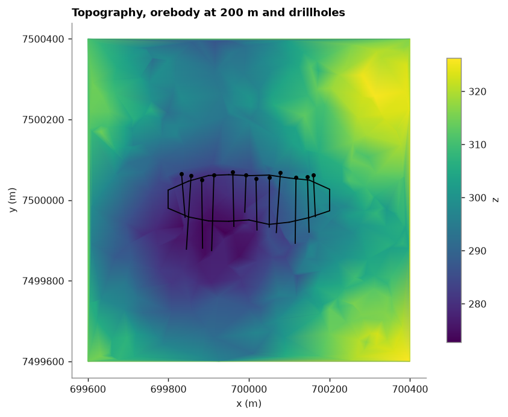

# Meshes, strings, points and tables

`wireframes` has three geometry containers. A `Mesh` holds triangles: an open surface such as topography, or a closed
solid such as an orebody. `Polylines` holds 3D strings grouped into features, and `PointSet` holds points. Each
carries attribute tables, a `crs` label and a `length_unit` label, and never changes once built: every method
returns a new object.

```python
import importlib.util

import numpy as np
import wireframes as wf
from common import save
```

## A mesh from arrays

A mesh takes `(n, 3)` vertices and `(m, 3)` triangles. A solid winds its triangles counter-clockwise seen from
outside, so its signed volume is positive. Here a 20 m cube gets a face column naming its sides.

```python
corners = np.array([[x, y, z] for z in (0, 20) for y in (0, 20) for x in (0, 20)], float)
faces = wf.datasets.box([0, 0, 0], [1, 1, 1]).triangles
sides = ["bottom", "bottom", "top", "top", "south", "south", "north", "north", "west", "west", "east", "east"]
cube = wf.Mesh(corners, faces, face_attributes={"side": sides}, crs="EPSG:31983", length_unit="m")
print(cube)
print(f"volume {cube.volume:.1f} m3, area {cube.area:.1f} m2, solid: {cube.is_solid}")
print(cube.to_table(on="faces").to_dict()["side"][:4])
```

```text
Mesh(8 vertices, 12 triangles, columns ["side"], crs EPSG:31983, length_unit m)
volume 8000.0 m3, area 2400.0 m2, solid: True
['bottom' 'bottom' 'top' 'top']
```

## Tables keep types and nulls

Attribute tables hold float64, int64, bool and string columns. `None` marks a null; numeric nulls come back as
NaN, and `mask` tells which rows hold a value.

```python
table = wf.Table({"hole": ["DH1", "DH2", None], "depth": [120.0, None, 80.5], "assayed": [True, False, True]})
print(table)
print(table["depth"], table.mask("hole"))
print(table.drop_null().num_rows, "rows without nulls")
```

```text
Table(3 rows; hole: utf8, depth: float64, assayed: bool)
[120.    nan  80.5] [ True  True False]
1 rows without nulls
```

## The synthetic deposit

`wf.datasets` builds a seeded synthetic deposit at UTM scale: a lens-shaped orebody, a rolling topography and a
fan of drillholes. The plan view draws the topography by elevation, the orebody outline at 200 m and the holes.

```python
orebody = wf.datasets.orebody()
topography = wf.datasets.topography()
holes = wf.datasets.drillholes()
collars = wf.PointSet(
    np.array([p[0] for p in holes.parts]), {"hole": holes.attributes["hole"]}, length_unit="m"
)
print(orebody, holes, collars, sep="\n")

outline = orebody.slice_by_plane(wf.datasets.ORIGIN + [0, 0, 200], [0, 0, 1])
fig, ax = wf.plot.plan([topography, outline, holes, collars], label=False)
ax.set_title("Topography, orebody at 200 m and drillholes")
save(fig, "basics")
```

```text
Mesh(216 vertices, 428 triangles, columns ["section"], crs None, length_unit m)
Polylines(12 features, 12 parts, 24 vertices, columns ["hole", "depth"])
PointSet(12 points, columns ["hole"])
```



Every container converts to a table, and from there to pandas, polars or pyarrow when they are installed.

```python
print(holes.to_table().column_names)
assert cube.volume == 8000.0
```

```text
['feature', 'part', 'vertex', 'x', 'y', 'z', 'closed', 'hole', 'depth']
```

## Joining meshes and editing tables

`wf.concat` appends meshes in order without welding, so volumes add. `with_attributes` swaps whole attribute
tables, and `Table.with_columns` adds several columns at once.

```python
second = cube.translate([40, 0, 0])
pair = wf.concat([cube, second])
print(pair.n_faces, "faces,", f"{pair.volume:.0f} m3")
assert pair.volume == cube.volume + second.volume
relabelled = pair.with_attributes(face={"block": [1] * 12 + [2] * 12})
print(relabelled.column_names, table.with_columns({"lab": ["A", "B", "C"]}).column_names)
```

```text
24 faces, 16000 m3
['block'] ['hole', 'depth', 'assayed', 'lab']
```

## Strings from a table

`Polylines.from_table` groups rows into features by an id column, as a CSV export of a pit crest would give.
`length` measures each feature in 3D, `contains` tests points in plan, and `to_points` turns every vertex into a
point with its feature, part and vertex index.

```python
crest = wf.Polylines.from_table(
    {"ID": ["pad"] * 4, "X": [0, 30, 30, 0], "Y": [0, 0, 30, 30], "Z": [5, 5, 5, 5]}, z="Z", closed=True
)
print(crest.length(), crest.contains([[15, 15], [45, 15]]))
assert crest.length()[0] == 120.0 and crest.contains([[15, 15]])[0]
vertices = crest.to_points()
print(vertices.column_names, len(vertices))
```

```text
[120.] [ True False]
['feature', 'part', 'ID'] 4
```

## Vertex tables, units and moved vertices

`vertex_attributes` holds one row per vertex, on meshes and on strings, and `Table.units` maps each column that
has a unit to it. `with_vertices` moves the vertices and keeps the triangles and every attribute, so lifting the
cube by 5 m keeps its volume and its `side` column.

```python
graded = cube.with_vertex_column("grade", np.linspace(0.5, 2.0, cube.n_vertices), unit="g/t")
print(graded.vertex_attributes.column_names, graded.vertex_attributes.units)
print(crest.vertex_attributes.num_rows, "crest vertex rows")
lifted = graded.with_vertices(graded.coords + [0, 0, 5])
print(lifted.bounds[0], lifted["side"][:2])
assert lifted.volume == cube.volume and graded.vertex_attributes.units == {"grade": "g/t"}
```

```text
['grade'] {'grade': 'g/t'}
4 crest vertex rows
[0.0, 0.0, 5.0] ['bottom' 'bottom']
```

## DataFrames

The DataFrame converters keep nulls and need only the library they name. A mesh converts its vertex table, or
its face table with `on="faces"`.

```python
if importlib.util.find_spec("pandas"):
    print("pandas:", table.to_pandas().shape, collars.to_pandas().shape, crest.to_pandas().shape)
    print(cube.to_pandas(on="faces").head(2))
if importlib.util.find_spec("polars"):
    print("polars:", table.to_polars().shape, collars.to_polars().shape, crest.to_polars().shape)
    assert cube.to_polars().height == cube.n_vertices
if importlib.util.find_spec("pyarrow"):
    print("pyarrow:", table.to_pyarrow().num_rows, collars.to_pyarrow().num_rows, crest.to_pyarrow().num_rows)
    assert cube.to_pyarrow(on="faces").num_rows == cube.n_faces
```

```text
pandas: (3, 3) (12, 4) (4, 8)
   v0  v1  v2    side
0   0   2   1  bottom
1   1   2   3  bottom
polars: (3, 3) (12, 4) (4, 8)
pyarrow: 3 12 4
```

## Errors

Every error the library raises derives from `wf.WireframesError`. An unknown column raises `wf.MissingColumn`,
which is also a `KeyError`, and its message lists the columns there are.

```python
try:
    table["grade"]
except wf.MissingColumn as error:
    print(f"{type(error).__name__}: {error}")
    assert isinstance(error, wf.WireframesError) and isinstance(error, KeyError)
else:
    raise AssertionError("an unknown column must be refused")
```

```text
MissingColumn: missing column "grade"; columns are ["hole", "depth", "assayed"]
```

Full script: [`example_00.py`](example_00.py), run by `mise run examples`.
