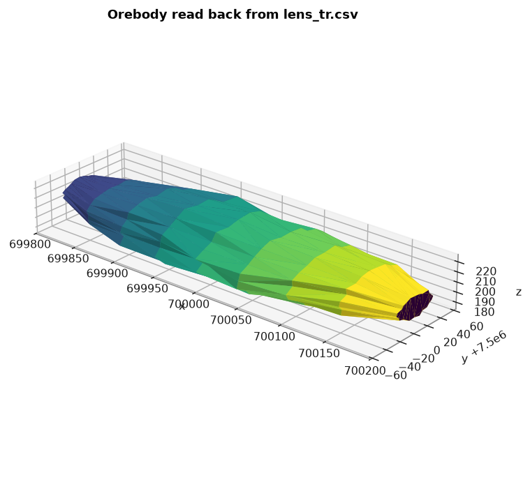

# Reading and writing files

`wf.read` returns everything a file holds as a `Dataset`: a mesh, polylines, points, a volume grid, the unit the
file declares and the reader's warnings. `wf.write` picks the format from the extension. Text formats print
floats in their shortest round-trip form, so coordinates survive a write and a read bit for bit.

```python
import numpy as np
import wireframes as wf
from common import save
```

## One mesh, every format

The orebody goes out to each format and comes back. STL and DXF 3DFACE store loose triangles, so their readers
weld equal corners and number vertices in first-use order. Every format but STL returns the triangles bit for
bit; STL stores 32-bit floats, whose spacing at a northing of 7.5 million is half a metre, so a vertex moves by
up to 0.25 m. Keep STL for local coordinates. Formats that cannot store a column skip it when asked to.

```python
orebody = wf.datasets.orebody()
original = orebody.coords[orebody.triangles]
folder = Path(tempfile.mkdtemp())
for name in [
    "lens.obj",
    "lens.ply",
    "lens.off",
    "lens.stl",
    "lens.dxf",
    "lens.vtk",
    "lens.vtu",
    "lens_tr.csv",
]:
    path = folder / name
    wf.write(path, orebody, skip_unsupported_columns=True)
    back = wf.read_mesh(path)
    shift = np.abs(back.coords[back.triangles] - original).max()
    print(
        f"{name:12} {path.stat().st_size:8,} bytes  largest shift {shift:.1e} m  columns {back.column_names}"
    )
    assert shift == 0.0 or (name.endswith(".stl") and shift <= 0.25)
```

```text
lens.obj       15,266 bytes  largest shift 0.0e+00 m  columns []
lens.ply       12,676 bytes  largest shift 0.0e+00 m  columns ['section']
lens.off       14,835 bytes  largest shift 0.0e+00 m  columns []
lens.stl       21,484 bytes  largest shift 2.5e-01 m  columns []
lens.dxf      103,261 bytes  largest shift 0.0e+00 m  columns ['layer']
lens.vtk       22,520 bytes  largest shift 0.0e+00 m  columns ['section']
lens.vtu       23,682 bytes  largest shift 0.0e+00 m  columns ['section']
lens_tr.csv     7,030 bytes  largest shift 0.0e+00 m  columns ['section']
```

## Strings, points and labels

Drillhole traces go to DXF as 3D polylines on a layer. `crs` and `length_unit` are labels set at read time; a
DXF that declares `$INSUNITS` sets the unit itself, and a disagreeing argument raises `InvalidInput`.

```python
holes = wf.datasets.drillholes()
wf.write(
    folder / "holes.dxf", holes.with_column("layer", holes.attributes["hole"]), skip_unsupported_columns=True
)
data = wf.read(folder / "holes.dxf", crs="EPSG:31983", length_unit="m")
print(data.polylines, data.polylines.crs, data.polylines.length_unit, data.warnings)
print(data.polylines.attributes["layer"][:3])
```

```text
Polylines(12 features, 12 parts, 24 vertices, columns ["layer"]) EPSG:31983 m []
['DH001' 'DH002' 'DH003']
```

## A Datamine pair

A Datamine wireframe is two CSV files, `<name>_tr.csv` and `<name>_pt.csv`; either name reads the pair.

```python
pair = wf.read_mesh(folder / "lens_pt.csv")
print((folder / "lens_tr.csv").read_text().splitlines()[:2])
print(pair)
```

```text
['TRIANGLE,PID1,PID2,PID3,section', '1,7,8,31,0']
Mesh(216 vertices, 428 triangles, columns ["section"], crs None, length_unit None)
```

The figure shows the mesh read back from the Datamine pair, coloured by the `section` column the loft wrote.

```python
fig, ax = wf.plot.surface3d(pair, "section", azim=-50, elev=25)
ax.set_title("Orebody read back from lens_tr.csv")
save(fig, "files")
```



## One kind of geometry at a time

`wf.read_polylines` and `wf.read_points` return just the strings or just the points of a file, for scripts that
expect one kind.

```python
collars = wf.PointSet(np.array([p[0] for p in holes.parts]), {"hole": holes.attributes["hole"]})
wf.write(folder / "collars.dxf", collars, skip_unsupported_columns=True)
traces = wf.read_polylines(folder / "holes.dxf")
points = wf.read_points(folder / "collars.dxf")
print(traces, points, sep="\n")
assert len(traces) == len(holes) and np.array_equal(points.coords, collars.coords)
```

```text
Polylines(12 features, 12 parts, 24 vertices, columns ["layer"])
PointSet(12 points, columns ["layer"])
```

## Volume cells

A `.vtu` or `.vtk` file with tetrahedra or hexahedra comes back as an `UnstructuredGrid`: points, VTK cell types,
connectivity with offsets, and point and cell data. wireframes keeps these cells as data so a reservoir or
finite-element mesh round-trips; `surface()` gives the triangles among them as a `Mesh`.

```python
(folder / "cells.vtk").write_text(
    "# vtk DataFile Version 3.0\ntetra and cap\nASCII\nDATASET UNSTRUCTURED_GRID\n"
    "POINTS 5 double\n0 0 0\n10 0 0\n0 10 0\n0 0 10\n10 10 0\n"
    "CELLS 2 9\n4 0 1 2 3\n3 1 4 2\nCELL_TYPES 2\n10\n5\n"
    "CELL_DATA 2\nSCALARS rock double 1\nLOOKUP_TABLE default\n1\n2\n"
)
grid = wf.read(folder / "cells.vtk").grid
print(grid.n_cells, grid.cell_types, grid.connectivity, grid.cell_data["rock"], grid.point_data.column_names)
cap = grid.surface()
print(cap)
wf.write(folder / "cells.vtu", grid)
again = wf.read(folder / "cells.vtu").grid
assert np.array_equal(again.connectivity, grid.connectivity) and cap.n_faces == 1
```

```text
2 [10  5] [0 1 2 3 1 4 2] [1. 2.] []
Mesh(5 vertices, 1 triangles, columns ["rock"], crs None, length_unit None)
```

Full script: [`example_01.py`](example_01.py), run by `mise run examples`.
