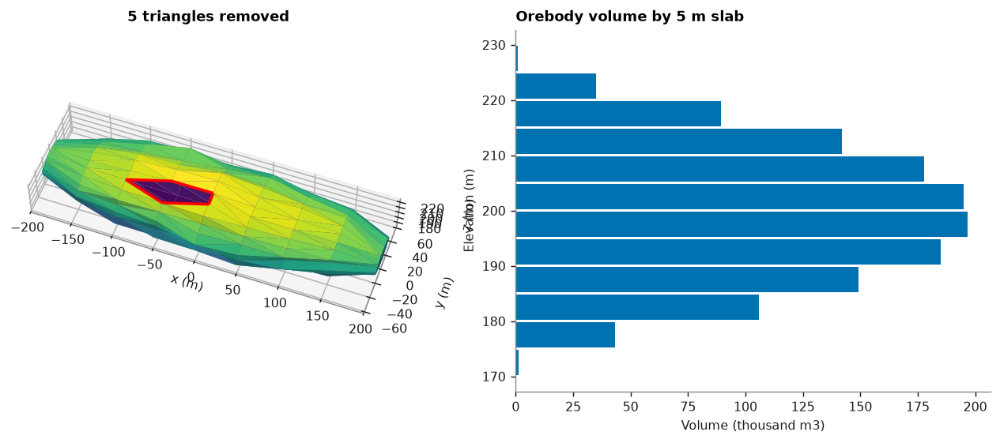

# Measuring, validating and repairing

Volumes decide tonnage, so `wireframes` measures only meshes it can trust. `Mesh.volume` refuses a mesh that is not
closed and consistently wound. `Mesh.validate` lists every problem with exact predicates, and `Mesh.repair`
fixes what can be fixed without guessing, recording each change in a `RepairReport`.

```python
import matplotlib.pyplot as plt
import numpy as np
import wireframes as wf
from common import ACCENT, save
```

## Measures of a solid

Volume, area and centroid integrate over the triangles after shifting them to the bounding-box corner, so UTM
coordinates keep their digits. `volume_by_elevation` integrates the same solid between elevation edges, and the
slabs add back to the volume.

```python
orebody = wf.datasets.orebody()
print(f"volume {orebody.volume:,.0f} m3, area {orebody.area:,.0f} m2")
print("centroid", np.round(orebody.centroid - wf.datasets.ORIGIN, 2))
lo, hi = orebody.bounds
edges = np.arange(np.floor(lo[2] / 5) * 5, hi[2] + 5, 5.0)
slabs = orebody.volume_by_elevation(edges)
print(f"slabs sum to the volume within {abs(slabs.sum() - orebody.volume):.2e} m3")
assert abs(slabs.sum() - orebody.volume) <= 1e-9 * orebody.volume
```

```text
volume 1,320,679 m3, area 101,093 m2
centroid [ -1.57   0.89 199.52]
slabs sum to the volume within 4.66e-10 m3
```

## A triangle soup from another package

Many exports write each triangle with its own three corners, flip some triangles and repeat others. Such a soup
has the right shape but no topology: every edge is a boundary edge, so `volume` refuses it.

```python
rng = np.random.default_rng(7)
corners = orebody.coords[orebody.triangles].reshape(-1, 3)
triangles = np.arange(len(corners)).reshape(-1, 3)
flip = rng.random(len(triangles)) < 0.25
triangles[flip] = triangles[flip][:, ::-1]
triangles = np.vstack([triangles, triangles[:6]])
soup = wf.Mesh(corners, triangles[rng.permutation(len(triangles))], length_unit="m")
report = soup.validate()
print(report)
try:
    _ = soup.volume
except wf.InvalidMesh as e:
    print("refused:", e)
```

```text
MeshReport(is_solid=false, shells=428, duplicate_faces=6, duplicate_vertices=1068, boundary_edges=1266, inconsistent_edges=18)
refused: invalid mesh: volume needs a closed, consistently wound mesh: duplicate_faces=6, duplicate_vertices=1068, boundary_edges=1266, inconsistent_edges=18; the error's report lists each problem (as mesh.validate() does), and mesh.repair() or repair=True fixes what repair can
```

`repair` welds equal corners, drops degenerate and duplicate faces and unused vertices, then orients each shell
outward. Every change is a row of the report, and `vertex_map` and `face_map` say where each input vertex and
face went.

```python
fixed, log = soup.repair()
print(log)
print(log.actions.to_dict()["action"][:3], "...")
print(f"repaired volume {fixed.volume:,.0f} m3, solid: {fixed.is_solid}")
assert abs(fixed.volume - orebody.volume) <= 1e-9 * orebody.volume
assert len(fixed.repair()[1]) == 0
```

```text
RepairReport(vertex_merged=1068, vertex_split=0, vertex_removed=0, face_removed=6, face_flipped=112, face_added=0, holes_left=0)
['vertex_merged' 'vertex_merged' 'vertex_merged'] ...
repaired volume 1,320,679 m3, solid: True
```

## Holes

Removing the triangles around the highest vertex opens a hole in the roof. `validate` reports its boundary edges,
and the 3D view (in coordinates local to the deposit origin) draws them in red.
`repair(fill_holes="min_area")` closes it with the smallest-area triangulation of the loop.

```python
roof = (orebody.triangles == np.argmax(orebody.z)).any(axis=1)
holed = orebody.filter_faces(~roof)
problems = holed.validate()
print(problems.summary["boundary_edges"], "boundary edges")
filled, fill_log = holed.repair(fill_holes="min_area")
print(fill_log.summary, f"volume change {filled.volume - orebody.volume:+.1f} m3")

fig = plt.figure(figsize=(10, 4.2), layout="constrained")
ax1 = fig.add_subplot(1, 2, 1, projection="3d")
wf.plot.surface3d(holed.translate(-wf.datasets.ORIGIN), ax=ax1, problems=problems, azim=-70, elev=55)
ax1.set_title(f"{roof.sum()} triangles removed")
ax2 = fig.add_subplot(1, 2, 2)
ax2.barh(0.5 * (edges[1:] + edges[:-1]), slabs / 1e3, height=4.5, color=ACCENT)
ax2.set_xlabel("Volume (thousand m3)")
ax2.set_ylabel("Elevation (m)")
ax2.set_title("Orebody volume by 5 m slab")
save(fig, "measure_repair")
```

```text
5 boundary edges
{'vertex_merged': 0, 'vertex_split': 0, 'vertex_removed': 0, 'face_removed': 0, 'face_flipped': 0, 'face_added': 3} volume change -3009.6 m3
```



The report also says where every input face went (`face_map`, -1 for a dropped face) and how many boundary loops
stayed open (`holes_left`), so a script can refuse a repair that left the solid open.

```python
print("soup faces dropped:", int((log.face_map < 0).sum()), "holes left:", fill_log.holes_left)
assert (log.face_map < 0).sum() == 6 and fill_log.holes_left == 0 and filled.is_solid
```

```text
soup faces dropped: 6 holes left: 0
```

Two stopes that share a corner edge are one valid solid with two shells in contact. `repair` keeps each
shell's own vertices there; `weld_touching_shells=True` merges them, and repairing that output splits them
again with `vertex_split` actions.

```python
stopes = wf.datasets.box([0, 0, 0], [10, 10, 20]) | wf.datasets.box([10, 10, 0], [20, 20, 20])
contact = stopes.validate().summary
print(
    contact["shells"],
    "shells,",
    contact["touching_shell_edges"],
    "touching edge, solid:",
    contact["is_solid"],
)
kept, kept_log = stopes.repair()
merged, merge_log = stopes.repair(weld_touching_shells=True)
split, split_log = merged.repair()
print(
    len(kept_log),
    "changes;",
    merge_log.summary["vertex_merged"],
    "merged;",
    split_log.summary["vertex_split"],
    "split",
)
assert len(kept_log) == 0 and merged.is_solid and split.n_vertices == stopes.n_vertices
```

```text
2 shells, 1 touching edge, solid: True
0 changes; 2 merged; 2 split
```

## Per-face measures

`face_areas` add up to `area`. `face_normals` are unit normals per triangle, `vertex_normals` average them by
corner angle, and `dip` gives each triangle's dip and dip direction in degrees, as a structural geologist reads a
fault plane.

```python
assert abs(orebody.face_areas.sum() - orebody.area) <= 1e-9 * orebody.area
print("normal lengths", np.unique(np.round(np.linalg.norm(orebody.face_normals, axis=1), 12)))
print("vertex normals", orebody.vertex_normals.shape)
dips = orebody.dip
print(f"steepest triangle dips {dips[:, 0].max():.1f} degrees")
```

```text
normal lengths [1.]
vertex normals (216, 3)
steepest triangle dips 90.0 degrees
```

## Moving, rescaling and splitting

`transform` applies a 4x4 affine matrix; a mirror flips the winding back so the solid stays outward.
`to_length_unit` rescales and relabels. `components` splits a mesh into edge-connected pieces, and
`component_labels` gives the piece of each triangle.

```python
mirror = np.diag([-1.0, 1.0, 1.0, 1.0])
assert abs(orebody.transform(mirror).volume - orebody.volume) <= 1e-9 * orebody.volume
in_feet = orebody.to_length_unit("ft")
print(in_feet.length_unit, f"{in_feet.volume:,.0f} ft3")
two = wf.concat([orebody, orebody.translate([500, 0, 0])])
pieces = two.components()
print(len(pieces), "components", np.bincount(two.component_labels()))
assert abs(sum(p.volume for p in pieces) - two.volume) <= 1e-9 * two.volume
```

```text
ft 46,639,348 ft3
2 components [428 428]
```

## Thickness between two surfaces

`thickness` measures from this surface down to another one, vertically or along the normal. A topography
lowered by 12 m is 12 m thick everywhere.

```python
topography = wf.datasets.topography(n=60)
floor = topography.translate([0, 0, -12])
probe = np.random.default_rng(3).uniform(topography.bounds[0][:2], topography.bounds[1][:2], (200, 2))
depth = topography.thickness(floor, probe)
print(np.round(depth[:5], 6))
assert np.allclose(depth, 12.0)
```

```text
[12. 12. 12. 12. 12.]
```

Full script: [`example_02.py`](example_02.py), run by `mise run examples`.
