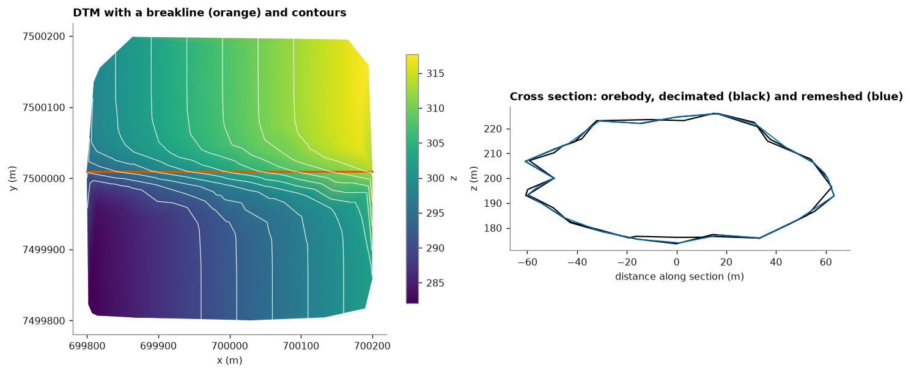

# Building surfaces and solids

`wf.dtm` triangulates survey points into a surface with constrained Delaunay, keeping breaklines as edges.
`wf.extrude`, `wf.loft` and `Mesh.close_to_elevation` turn strings and surfaces into solids, and `decimate`,
`smooth`, `remesh` and `offset` edit meshes. Each solid comes out validated.

```python
import matplotlib.pyplot as plt
import numpy as np
import wireframes as wf
from common import ACCENT, HIGHLIGHT, save
```

## A surface with a breakline

A road crest surveyed as a string must stay an edge of the surface. Without the breakline, triangles cross it
and the surface cuts the corner of the road.

```python
o = wf.datasets.ORIGIN
rng = np.random.default_rng(11)
xy = rng.uniform(-200, 200, (300, 2))
z = 300 + 0.05 * xy[:, 0] + 8 * np.tanh(xy[:, 1] / 30)
survey = wf.PointSet(o + np.column_stack([xy, z]), length_unit="m")
crest_x = np.linspace(-200, 200, 9)
crest = wf.Polylines([o + np.column_stack([crest_x, np.full(9, 10.0), 300 + 0.05 * crest_x + 3])])
plain = wf.dtm(survey)
road = wf.dtm(survey, breaklines=crest)
print(plain, road, sep="\n")
```

```text
Mesh(300 vertices, 582 triangles, columns [], crs None, length_unit m)
Mesh(309 vertices, 599 triangles, columns [], crs None, length_unit m)
```

## Contours and a solid down to a floor

`contours` slices the surface at each level. `close_to_elevation` drops walls from the boundary of a
height-field surface to a flat floor; its volume equals the fill of the surface over a flat plane at that
elevation, which `cut_fill` computes independently.

```python
lines = road.contours(np.arange(290.0, 315.0, 2.5))
print(lines)
solid = road.close_to_elevation(250.0)
lo, hi = road.bounds
corners = [[lo[0], lo[1], 250.0], [hi[0], lo[1], 250.0], [hi[0], hi[1], 250.0], [lo[0], hi[1], 250.0]]
floor = wf.dtm(np.array(corners))
fill = wf.cut_fill(floor, road)["fill"]
print(f"solid {solid.volume:,.1f} m3, cut_fill against the floor {fill:,.1f} m3")
assert solid.is_solid and abs(solid.volume - fill) <= 1e-8 * fill
```

```text
Polylines(10 features, 10 parts, 394 vertices, columns ["elevation"])
solid 7,621,095.6 m3, cut_fill against the floor 7,621,095.6 m3
```

## Solids from strings

`extrude` sweeps closed rings along a vector; `loft` links one section ring to the next, choosing the
triangles of each band by dynamic programming to minimise their area.

```python
pad = wf.Polylines([[[0, 0], [40, 0], [40, 25], [15, 40], [0, 25]]], closed=True, length_unit="m")
stockpile = wf.extrude(pad, [0, 0, 12])
print(f"extruded {stockpile.volume:,.1f} m3 = area {pad.area()[0]:,.1f} m2 x 12 m")
assert abs(stockpile.volume - pad.area()[0] * 12) <= 1e-9 * stockpile.volume
square = np.array([[0, 0, 0], [10, 0, 0], [10, 10, 0], [0, 10, 0]], float)
column = wf.loft(wf.Polylines([square, square * [0.6, 0.6, 1] + [2, 2, 20]], closed=True))
frustum = 20 / 3 * (100 + 36 + np.sqrt(100 * 36))
print(f"lofted frustum {column.volume:,.4f} m3, analytic {frustum:,.4f} m3, solid: {column.is_solid}")
assert abs(column.volume - frustum) <= 1e-9 * frustum
```

```text
extruded 15,600.0 m3 = area 1,300.0 m2 x 12 m
lofted frustum 1,306.6667 m3, analytic 1,306.6667 m3, solid: True
```

The first or last section may be an open line or a single point, where a vein pinches out: a 10 x 4 m
section lofted to a line 30 m away is a wedge, and lofted to a point it is a pyramid.

```python
vein = np.array([[0, -5, -2], [0, 5, -2], [0, 5, 2], [0, -5, 2]], float)
wedge = wf.loft(wf.Polylines([vein, [[30, -5, 0], [30, 5, 0]]], closed=[True, False]))
pyramid = wf.loft(wf.Polylines([vein, [[30, 0, 0]]], closed=[True, False]))
print(f"pinched to a line {wedge.volume:,.1f} m3, to a point {pyramid.volume:,.1f} m3")
assert abs(wedge.volume - 600) <= 1e-9 * 600 and abs(pyramid.volume - 400) <= 1e-9 * 400
```

```text
pinched to a line 600.0 m3, to a point 400.0 m3
```

`triangulate` fills each feature's closed rings with triangles, treating inner rings as holes by even-odd, so a
pad with a sump becomes a flat mesh whose area is the polygon area.

```python
sump = [[15, 10], [25, 10], [25, 20], [15, 20]]
holed_pad = wf.Polylines([pad.parts[0][:, :2], sump], closed=True, features=[0, 0])
floor = wf.triangulate(holed_pad)
print(f"triangulated {floor.n_faces} triangles, {floor.area:,.1f} m2 = {holed_pad.area()[0]:,.1f} m2")
assert abs(floor.area - holed_pad.area()[0]) <= 1e-9 * floor.area
```

```text
triangulated 9 triangles, 1,200.0 m2 = 1,200.0 m2
```

## Editing meshes

`decimate` collapses edges by quadric error and keeps a solid closed; `smooth` applies Taubin's
smoothing with the boundary fixed, which changes a solid's volume a little unless you pass
`preserve_volume=True`; `remesh` evens out edge lengths; `offset` moves every vertex along its normal and
refuses a result that intersects itself.

```python
orebody = wf.datasets.orebody()
light = orebody.decimate(target_faces=150)
smooth = orebody.smooth(iterations=5)
kept = orebody.smooth(iterations=5, preserve_volume=True)
even = orebody.remesh(15.0, iterations=3)
grown = orebody.offset(2.0)
edits = [
    ("decimate", light),
    ("smooth", smooth),
    ("smooth, kept", kept),
    ("remesh", even),
    ("offset 2 m", grown),
]
for name, m in edits:
    print(f"{name:12} {m.n_faces:5} triangles, volume {m.volume:12,.0f} m3, closed: {m.is_closed}")
print(f"smooth changes the volume by {100 * (smooth.volume / orebody.volume - 1):+.2f} percent")
assert kept.is_solid and abs(kept.volume / orebody.volume - 1) < 1e-12
```

```text
decimate       150 triangles, volume    1,306,765 m3, closed: True
smooth         428 triangles, volume    1,316,878 m3, closed: True
smooth, kept   428 triangles, volume    1,320,679 m3, closed: True
remesh        1200 triangles, volume    1,302,774 m3, closed: True
offset 2 m     428 triangles, volume    1,509,352 m3, closed: True
smooth changes the volume by -0.29 percent
```

```python
fig, (ax1, ax2) = plt.subplots(1, 2, figsize=(11, 4.6), layout="constrained")
wf.plot.plan(road, ax=ax1)
for part in crest.parts:
    ax1.plot(part[:, 0], part[:, 1], color=HIGHLIGHT, linewidth=1.6)
for part in lines.parts:
    ax1.plot(part[:, 0], part[:, 1], color="w", linewidth=0.6)
ax1.set_title("DTM with a breakline (orange) and contours")
wf.plot.section([orebody, light], o, [1, 0, 0], ax=ax2)
ring = even.slice_by_plane(o, [1, 0, 0])
for part, closed in zip(ring.parts, ring.closed, strict=True):
    part = np.vstack([part, part[:1]]) if closed else part
    ax2.plot(part[:, 1] - o[1], part[:, 2], color=ACCENT, linewidth=1.0)
ax2.set_title("Cross section: orebody, decimated (black) and remeshed (blue)")
save(fig, "construct")
```



Full script: [`example_05.py`](example_05.py), run by `mise run examples`.
