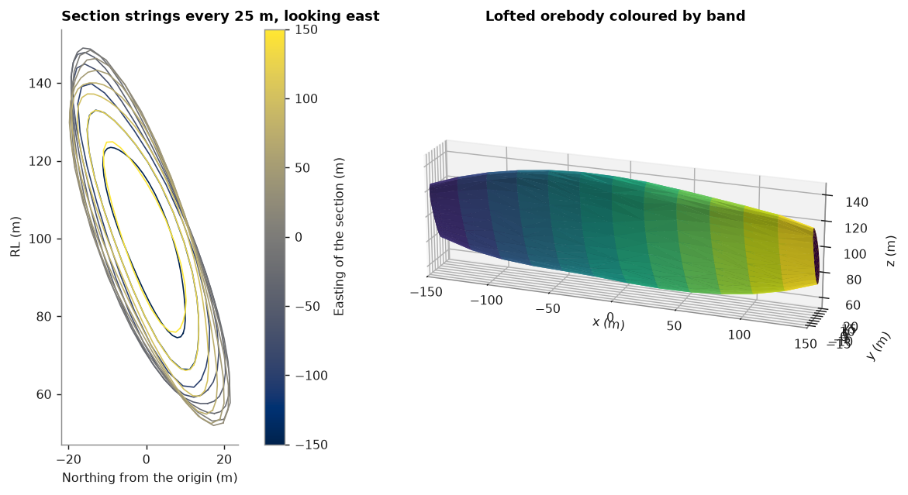
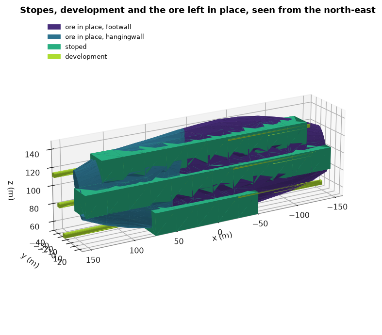
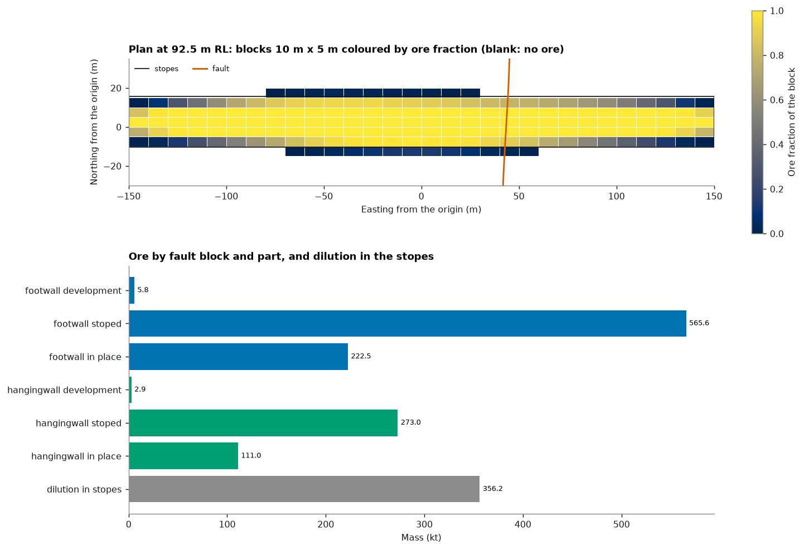
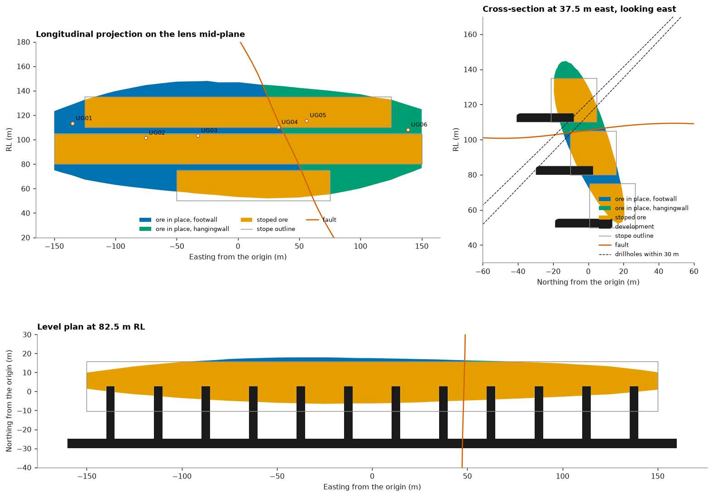

# Underground: orebody, fault, stopes, drillholes and a tonnage report

This example follows an underground workflow from a geological interpretation to a tonnage report, and checks each
number by a second route. It lofts an orebody from section strings, splits it along a fault, unites a block of
stopes and subtracts the development, intersects desurveyed drillholes with the orebody, reports tonnes and metal
from exact block fractions, and draws sections through the result.

All data are seeded and synthetic, at UTM scale: easting near 700 000 m and northing near 7 500 000 m. Elevations
are reduced levels (RL) in metres above the mine datum. Lengths are in metres (m), volumes in cubic metres (m3),
densities in tonnes per cubic metre (t/m3), masses in tonnes (t, kt for 1 000 t), gold grades in grams per tonne
(g/t) and gold metal in kilograms (kg).

```python
import matplotlib.pyplot as plt
import numpy as np
import wireframes as wf
from common import GRAY, HIGHLIGHT, INK, SERIES, save
from matplotlib.patches import Patch

O = wf.datasets.ORIGIN
EAST, NORTH, UP = np.eye(3)
```

## 1. The orebody from section strings

A geologist interprets drilling on vertical *cross-sections*, planes across the orebody, and draws the outline
of the ore on each one as a closed *section string*. Here the orebody is a gold lens that *strikes* east (its
long horizontal direction) and *dips* 70 degrees to the north (the angle of its plane below the horizontal). The
sections stand every 25 m along strike, from 150 m west of the origin to 150 m east, and face east.

Each string is an ellipse 100 m long down dip and about 24 m thick, tapering towards both ends of the lens, with
a seeded wobble and its own number of points, since no two sections are digitized alike.

```python
DIP = np.radians(70.0)
DOWN_DIP = np.array([0.0, np.cos(DIP), -np.sin(DIP)])
ACROSS = np.array([0.0, np.sin(DIP), np.cos(DIP)])
CENTRE_RL = 100.0
rng = np.random.default_rng(2026)
rings = []
for x in np.arange(-150.0, 151.0, 25.0):
    n = int(rng.integers(24, 48))
    angle = np.linspace(0.0, 2.0 * np.pi, n, endpoint=False) + rng.uniform(0, 2 * np.pi / n)
    taper = np.sqrt(1.0 - (x / 175.0) ** 2)
    wobble = 1.0 + 0.06 * np.sin(3.0 * angle + x / 40.0)
    down = 50.0 * taper * wobble * np.cos(angle)
    thick = 12.0 * taper * wobble * np.sin(angle)
    rings.append(O + [x, 0.0, CENTRE_RL] + np.outer(down, DOWN_DIP) + np.outer(thick, ACROSS))
sections = wf.Polylines(rings, closed=True, length_unit="m")
print(sections)
print("points per section:", [len(r) for r in rings])
```

```text
Polylines(13 features, 13 parts, 449 vertices, columns [])
points per section: [44, 28, 25, 32, 40, 45, 26, 31, 30, 39, 39, 43, 27]
```

`wf.loft` links each string to the next with a band of triangles and caps the two end sections, which gives a
*solid*: a closed, consistently wound set of triangles with an inside and an outside, so it has a volume.
The loft keeps every string vertex as a vertex of the solid, so the solid honours the interpretation exactly on
each section. The check below asserts that, and that the result is a valid solid.

```python
orebody = wf.loft(sections)
print(orebody)
print(f"orebody volume {orebody.volume:,.0f} m3, solid: {orebody.is_solid}")
assert orebody.is_solid
assert {tuple(p) for p in sections.coords} <= {tuple(p) for p in orebody.coords}
```

```text
Mesh(449 vertices, 894 triangles, columns ["section"], crs None, length_unit m)
orebody volume 421,681 m3, solid: True
```

The left panel overlays every string on one cross-section, looking east and coloured by easting, so the dip and
the taper show. The right panel shows the lofted solid, coloured by its `section` face column, the number of the
band each triangle belongs to (the end caps are -1 and -2).

```python
fig = plt.figure(figsize=(11.5, 4.8), layout="constrained")
ax1 = fig.add_subplot(1, 2, 1)
eastings = plt.Normalize(-150, 150)
for ring in sections.parts:
    closed = np.vstack([ring, ring[:1]]) - O
    ax1.plot(closed[:, 1], closed[:, 2], color=plt.get_cmap("cividis")(eastings(closed[0, 0])), linewidth=0.9)
fig.colorbar(plt.cm.ScalarMappable(eastings, "cividis"), ax=ax1, label="Easting of the section (m)")
ax1.set_aspect("equal")
ax1.set_title("Section strings every 25 m, looking east")
ax1.set_xlabel("Northing from the origin (m)")
ax1.set_ylabel("RL (m)")
ax2 = fig.add_subplot(1, 2, 2, projection="3d")
wf.plot.surface3d(orebody.translate(-O), "section", ax=ax2, azim=-70, elev=20)
ax2.set_title("Lofted orebody coloured by band")
save(fig, "underground_loft")
```



## 2. Splitting the orebody along a fault

A *fault* is a fracture along which the rock on one side moved against the other. Here it is an open surface
that strikes north and dips 65 degrees east, crossing the lens about 40 m east of the origin, with a 2 m
roughness. The block above an inclined fault is the *hangingwall*, the block below it the *footwall*. Mine
geologists estimate and report each fault block on its own, because grade and continuity change across faults.

The fault grid winds its triangles so their normals point up and east. `clip_by_surface` returns the part of the
solid below the surface and the part above it, on the side the normals point to, so the hangingwall comes
second. Each part is closed by a cap cut from the fault, and the two caps are the same piece of fault.

```python
FAULT_DIP = np.radians(65.0)
f_down = np.array([np.cos(FAULT_DIP), 0.0, -np.sin(FAULT_DIP)])
f_normal = np.array([np.sin(FAULT_DIP), 0.0, np.cos(FAULT_DIP)])
u, w = np.meshgrid(np.linspace(-220, 220, 89), np.linspace(-200, 200, 41))
rough = 2.0 * np.sin(u / 31.0) * np.cos(w / 17.0)
fault_xyz = (
    O
    + [40.0, 0.0, CENTRE_RL]
    + np.outer(u.ravel(), NORTH)
    + np.outer(w.ravel(), f_down)
    + np.outer(rough.ravel(), f_normal)
)
nu = u.shape[1]
quads = [
    (j * nu + i, j * nu + i + 1, (j + 1) * nu + i + 1, (j + 1) * nu + i) for j in range(40) for i in range(88)
]
fault = wf.Mesh(fault_xyz, [t for a, b, c, d in quads for t in ((a, c, b), (a, d, c))], length_unit="m")
fault = fault.with_face_column("surface", ["fault"] * fault.n_faces)
print(f"fault normal of the first face: {np.round(fault.face_normals[0], 3)}")
footwall, hangingwall = orebody.clip_by_surface(fault)
for name, block in [("footwall", footwall), ("hangingwall", hangingwall)]:
    print(
        f"{name:11}: {block.volume:10,.0f} m3, solid: {block.is_solid}, centroid easting {block.centroid[0] - O[0]:+.1f} m"
    )
print(f"footwall + hangingwall - orebody = {footwall.volume + hangingwall.volume - orebody.volume:+.1e} m3")
assert footwall.is_solid and hangingwall.is_solid
assert footwall.centroid[0] < hangingwall.centroid[0]
assert abs(footwall.volume + hangingwall.volume - orebody.volume) <= 1e-9 * orebody.volume
```

```text
fault normal of the first face: [ 0.878 -0.033  0.478]
footwall   :    283,527 m3, solid: True, centroid easting -41.2 m
hangingwall:    138,154 m3, solid: True, centroid easting +84.6 m
footwall + hangingwall - orebody = -3.8e-08 m3
```

## 3. Stopes and development

A *stope* is the opening from which ore is mined. This mine uses open stopes 25 m long along strike and 25 m
high, mined between *levels*, horizontal working horizons every 30 m (50, 80 and 110 m RL). The 5 m of rock left
above each stope is the *crown pillar*. Each stope is a box that covers the ore at its mid height: 26 m wide
across strike, centred on the lens. The lens dips, so the vertical stope walls take some waste (*dilution*)
and leave some ore behind (*ore loss*).

A stope is designed only where it pays. Here the rule is that at least 40 percent of the stope volume must be
ore, measured with the exact intersection `stope & orebody`.

```python
LEVELS = [50.0, 80.0, 110.0]
PANELS = np.arange(-150.0, 150.0, 25.0)


def lens_y(rl):
    return (CENTRE_RL - rl) / np.tan(DIP)


shares, kept = [], []
for level in LEVELS:
    y_mid = lens_y(level + 12.5)
    row = []
    for x0 in PANELS:
        stope = wf.datasets.box(O + [x0, y_mid - 13.0, level], O + [x0 + 25.0, y_mid + 13.0, level + 25.0])
        row.append((stope & orebody).volume / stope.volume)
        if row[-1] >= 0.4:
            kept.append((level, x0, stope))
    shares.append(row)
print("ore share of each candidate stope, west to east")
for level, row in zip(LEVELS, shares, strict=True):
    print(f"{level:5.0f} m RL: " + " ".join(f"{s:4.2f}" for s in row))
print(f"{len(kept)} of {len(LEVELS) * len(PANELS)} candidate stopes reach 40 percent ore")
```

```text
ore share of each candidate stope, west to east
   50 m RL: 0.04 0.16 0.28 0.38 0.45 0.49 0.50 0.47 0.40 0.30 0.17 0.04
   80 m RL: 0.54 0.71 0.81 0.87 0.89 0.89 0.88 0.86 0.83 0.78 0.69 0.55
  110 m RL: 0.31 0.52 0.63 0.70 0.74 0.78 0.81 0.81 0.78 0.70 0.54 0.30
27 of 36 candidate stopes reach 40 percent ore
```

Neighbouring stopes on one level share a whole face. Their union merges the shared faces, so each level becomes
one shell, and the three levels, apart by their crown pillars, become three shells of one solid. The stopes touch
but do not overlap, so the union's volume must equal the sum of the stope volumes.

```python
stopes = kept[0][2]
for _, _, stope in kept[1:]:
    stopes = stopes | stope
print(stopes)
print(f"stopes: {stopes.volume:,.0f} m3 in {len(stopes.components())} shells, solid: {stopes.is_solid}")
assert stopes.is_solid
assert abs(stopes.volume - sum(s.volume for _, _, s in kept)) <= 1e-9 * stopes.volume
```

```text
Mesh(120 vertices, 228 triangles, columns [], crs None, length_unit m)
stopes: 438,750 m3 in 3 shells, solid: True
```

*Development* is the network of tunnels that gives access to the stopes. On each level a *footwall drive* runs
along strike 30 m south of the lens, in the footwall rock, and a *crosscut* runs north from the drive's
centreline to the middle of each stope floor. Drives are 5 m wide and crosscuts 4.5 m, both with 3.5 m walls
and a 1.5 m arch. `wf.extrude` sweeps the closed profile string along a straight line, so each drive and
crosscut is a prism whose volume is profile area times length.

The crosscuts on one level do not touch each other, so `wf.concat` stacks them into one mesh of separate shells,
which is a valid solid, and one union joins them to the drive. Joining them one at a time does not work here;
section 7 shows why.

```python
def profile(width, wall=3.5, arch=1.5, n=12):
    t = np.linspace(0.0, np.pi, n)[1:-1]
    half = width / 2.0
    across = np.concatenate([[-half, half, half], half * np.cos(t), [-half]])
    up = np.concatenate([[0.0, 0.0, wall], wall + arch * np.sin(t), [wall]])
    area = 0.5 * abs(np.dot(across, np.roll(up, -1)) - np.dot(up, np.roll(across, -1)))
    return across, up, area


def prism(ring, vector, area):
    solid = wf.extrude(wf.Polylines([ring], closed=True, length_unit="m"), vector)
    expected = area * np.linalg.norm(vector)
    assert solid.is_solid and abs(solid.volume - expected) <= 1e-9 * expected
    return solid


level_development, crosscuts = [], {}
for level in LEVELS:
    y_mid = lens_y(level + 12.5)
    y_drive = y_mid - 30.0
    a, v, area = profile(5.0)
    drive = prism(
        O + np.column_stack([np.full(a.size, -160.0), y_drive + a, level + v]), [320.0, 0.0, 0.0], area
    )
    a, v, area = profile(4.5)
    crosscuts[level] = [
        prism(
            O + np.column_stack([x0 + 12.5 + a, np.full(a.size, y_drive), level + v]), [0.0, 30.0, 0.0], area
        )
        for lv, x0, _ in kept
        if lv == level
    ]
    access = wf.concat(crosscuts[level])
    joined = drive | access
    overlap = (drive & access).volume
    print(
        f"{level:5.0f} m RL: drive {drive.volume:7,.0f} m3, {len(crosscuts[level])} crosscuts "
        f"{access.volume:6,.0f} m3, overlap {overlap:5,.0f} m3, joined {joined.volume:7,.0f} m3"
    )
    assert joined.is_solid
    assert abs(joined.volume + overlap - drive.volume - access.volume) <= 1e-9 * joined.volume
    level_development.append(joined)
development = wf.concat(level_development)
print(f"development: {development.volume:,.0f} m3, solid: {development.is_solid}")
assert development.is_solid
```

```text
   50 m RL: drive   7,459 m3, 5 crosscuts  3,147 m3, overlap   252 m3, joined  10,354 m3
   80 m RL: drive   7,459 m3, 12 crosscuts  7,553 m3, overlap   605 m3, joined  14,407 m3
  110 m RL: drive   7,459 m3, 10 crosscuts  6,294 m3, overlap   504 m3, joined  13,249 m3
development: 38,011 m3, solid: True
```

The crosscuts end inside the stopes, so part of each stope is already mined as development. The stope tonnes
must exclude it, otherwise that rock is reported twice. `stopes - development` gives the stoped volume; together
with `stopes & development` it must make up the stopes, and together with the development it must make up the
whole excavation, `stopes | development`.

```python
stoped = stopes - development
shared = stopes & development
mined = stopes | development
print(
    f"stoped {stoped.volume:,.1f} m3 + development inside stopes {shared.volume:,.1f} m3 = {stopes.volume:,.1f} m3"
)
print(
    f"stoped {stoped.volume:,.1f} m3 + development {development.volume:,.1f} m3 = excavation {mined.volume:,.1f} m3"
)
assert stoped.is_solid and shared.is_solid and mined.is_solid
assert abs(stoped.volume + shared.volume - stopes.volume) <= 1e-9 * stopes.volume
assert abs(stoped.volume + development.volume - mined.volume) <= 1e-9 * mined.volume
```

```text
stoped 431,386.1 m3 + development inside stopes 7,363.9 m3 = 438,750.0 m3
stoped 431,386.1 m3 + development 38,011.1 m3 = excavation 469,397.2 m3
```

Each fault block of the orebody now splits three ways: ore in development, ore in stopes, and ore left in place
(in pillars, beyond the stope walls and in the stopes that did not pay). The three parts of each block must add
up to the block.

```python
blocks = {"footwall": footwall, "hangingwall": hangingwall}
parts = {}
for name, block in blocks.items():
    parts[name, "development"] = block & development
    parts[name, "stoped"] = block & stoped
    parts[name, "in place"] = block - mined
    total = sum(parts[name, c].volume for c in ("development", "stoped", "in place"))
    print(
        f"{name:11}: development {parts[name, 'development'].volume:8,.0f} m3, stoped "
        f"{parts[name, 'stoped'].volume:9,.0f} m3, in place {parts[name, 'in place'].volume:9,.0f} m3, "
        f"sum - block {total - block.volume:+.1e} m3"
    )
    assert all(parts[name, c].is_solid for c in ("development", "stoped", "in place"))
    assert abs(total - block.volume) <= 1e-9 * block.volume
```

```text
footwall   : development    2,079 m3, stoped   201,982 m3, in place    79,465 m3, sum - block -9.8e-08 m3
hangingwall: development    1,028 m3, stoped    97,493 m3, in place    39,634 m3, sum - block +1.2e-07 m3
```

```python
fig = plt.figure(figsize=(11.5, 5.2), layout="constrained")
ax = fig.add_subplot(projection="3d")
shown = [
    (parts["footwall", "in place"], "ore in place, footwall"),
    (parts["hangingwall", "in place"], "ore in place, hangingwall"),
    (stoped, "stoped"),
    (development, "development"),
]
labelled = [m.translate(-O).with_face_column("part", [label] * m.n_faces) for m, label in shown]
wf.plot.surface3d(wf.concat(labelled), "part", ax=ax, azim=60, elev=20)
swatches = [
    Patch(color=plt.get_cmap("viridis")((k + 0.5) / len(shown)), label=lab)
    for k, (_, lab) in enumerate(shown)
]
ax.legend(handles=swatches, loc="upper left", fontsize=7)
ax.set_title("Stopes, development and the ore left in place, seen from the north-east")
save(fig, "underground_mining")
```



## 4. Drillhole intersections

A drillhole starts at its *collar* and is surveyed downhole: every 30 m a camera reads the *azimuth* (the
direction in plan, in degrees clockwise from north) and the *dip* (the angle below the horizontal, negative
down). Distance along the hole from the collar is the *measured depth*. *Desurveying* turns the survey into a
3D trace. The average angle method below gives each 30 m segment the mean of the azimuths and dips at its two
ends.

Six holes are collared on surface at 330 m RL, 200 m north of the lens, and drilled south at about -48
degrees, so they cut the north-dipping lens at a high angle. Each hole drifts by a seeded few degrees, as real
holes do.

```python
def desurvey(collar, depth, azimuth, dip):
    az, dp = np.radians(azimuth), np.radians(dip)
    a, d = (az[:-1] + az[1:]) / 2.0, (dp[:-1] + dp[1:]) / 2.0
    step = (
        np.column_stack([np.sin(a) * np.cos(d), np.cos(a) * np.cos(d), np.sin(d)]) * np.diff(depth)[:, None]
    )
    return collar + np.vstack([np.zeros(3), np.cumsum(step, axis=0)])


rng = np.random.default_rng(7)
depth = np.arange(0.0, 451.0, 30.0)
holes = {}
for k, x in enumerate(np.arange(-125.0, 126.0, 50.0)):
    azimuth = 180.0 + rng.uniform(-4, 4) + rng.uniform(-1.5, 1.5) * depth / 100.0
    dip = -48.0 + rng.uniform(-2, 2) + rng.uniform(0.0, 1.0) * depth / 100.0
    holes[f"UG{k + 1:02d}"] = desurvey(O + [x, 200.0, 330.0], depth, azimuth, dip)
print(f"{len(holes)} holes, {depth[-1]:.0f} m each, survey stations every {depth[1]:.0f} m")
```

```text
6 holes, 450 m each, survey stations every 30 m
```

`trace_intervals` splits each trace into alternating runs outside and inside a solid, with the measured depth
where each run starts (`from`) and ends (`to`) and the faces the trace crosses there. The runs inside the
orebody are the *intercepts*: the trace enters the ore at `from` and leaves it at `to`.

The intercept length is the *apparent thickness*. The *true thickness* is measured across the lens, at right
angles to it, so it is the intercept length times the cosine of the angle between the hole and the lens normal.

Two checks test the intercepts. The entry and exit points, interpolated along the trace at the reported depths,
lie on the orebody surface. And the lengths inside the footwall and hangingwall blocks add up to the length
inside the orebody, hole by hole.

```python
print(
    f"{'hole':5} {'from (m)':>9} {'to (m)':>8} {'length (m)':>11} {'true (m)':>9} "
    f"{'footwall (m)':>13} {'hangingwall (m)':>16} {'fault at (m)':>13}"
)
intercepts = []
for name, trace in holes.items():
    runs = orebody.trace_intervals(trace, depth)
    ore = runs.filter(runs["inside"])
    for start, end in zip(ore["from"], ore["to"], strict=True):
        entry, exit_ = (
            np.column_stack([np.interp(d, depth, trace[:, i]) for i in range(3)])[0] for d in (start, end)
        )
        assert orebody.distance([entry, exit_]).max() <= 1e-6
        true = (end - start) * abs((exit_ - entry) @ ACROSS) / np.linalg.norm(exit_ - entry)
        intercepts.append((name, start, end))
        per_block = []
        for block in (footwall, hangingwall):
            r = block.trace_intervals(trace, depth)
            overlap = np.minimum(r["to"], end) - np.maximum(r["from"], start)
            per_block.append(np.clip(overlap, 0.0, None)[r["inside"]].sum())
        hits = fault.segment_hits(trace[:-1], trace[1:])
        fault_depth = depth[hits["segment"]] + hits["t"] * np.diff(depth)[hits["segment"]]
        print(
            f"{name:5} {start:9.2f} {end:8.2f} {end - start:11.2f} {true:9.2f} "
            f"{per_block[0]:13.2f} {per_block[1]:16.2f} {', '.join(f'{d:.2f}' for d in fault_depth) or '-':>13}"
        )
        assert abs(sum(per_block) - (end - start)) <= 1e-9 * (end - start)
assert len(intercepts) == len(holes)
```

```text
hole   from (m)   to (m)  length (m)  true (m)  footwall (m)  hangingwall (m)  fault at (m)
UG01     291.37   305.99       14.63     13.09         14.63             0.00             -
UG02     292.14   316.12       23.98     21.27         23.98             0.00             -
UG03     290.82   316.87       26.05     23.00         26.05             0.00        107.47
UG04     287.34   313.49       26.15     23.42         21.69             4.46        291.80
UG05     285.83   310.33       24.50     22.17          0.00            24.50        354.54
UG06     293.52   308.51       14.98     13.26          0.00            14.98             -
```

## 5. Block model fractions and the tonnage report

A *block model* divides the ground into regular blocks, each carrying estimated properties. The blocks here are
10 m along strike, 5 m across and 5 m high (250 m3). The *grade*, the gold content in grams per tonne of rock,
comes from a smooth synthetic field that stands in for an estimate such as kriging; estimation itself belongs in
a block-modelling package. Ore has a dry bulk density of 2.8 t/m3 and waste 2.7 t/m3 (synthetic values).

A block on the edge of the orebody is partly ore. `block_fraction` gives, for every block, the fraction of its
volume inside a solid. It integrates the solid's surface over each block with the divergence theorem, so there
is no sampling error, and fraction times block volume, summed over blocks that cover the solid, gives back the
solid's volume.

```python
SIZE = np.array([10.0, 5.0, 5.0])
lo, hi = orebody.bounds
axes = [np.arange(np.floor((lo[i] - O[i]) / SIZE[i]), np.ceil((hi[i] - O[i]) / SIZE[i])) for i in range(3)]
grid = np.stack(np.meshgrid(*axes, indexing="ij"), axis=-1).reshape(-1, 3)
centres = O + (grid + 0.5) * SIZE
x, y, z = (centres - O).T
grade = 3.0 + 1.5 * np.sin(x / 45.0) * np.cos((z - CENTRE_RL) / 30.0) + 0.6 * np.cos(y / 9.0)
DENSITY_ORE, DENSITY_WASTE = 2.8, 2.7
print(f"{len(centres):,} blocks of {SIZE.prod():.0f} m3, grade {grade.min():.2f} to {grade.max():.2f} g/t")

fraction = {"orebody": orebody.block_fraction(centres, SIZE)}
for name, block in blocks.items():
    fraction[name] = block.block_fraction(centres, SIZE)
for key, solid in parts.items():
    fraction[key] = solid.block_fraction(centres, SIZE)
solids = {"orebody": orebody, **blocks, **parts}
for key, f in fraction.items():
    solid = solids[key]
    assert abs(f.sum() * SIZE.prod() - solid.volume) <= 1e-8 * solid.volume
print(
    f"{np.count_nonzero(fraction['orebody']):,} blocks hold ore, {np.sum(fraction['orebody'] == 1.0):,} are all ore"
)
```

```text
5,400 blocks of 250 m3, grade 1.03 to 5.06 g/t
2,472 blocks hold ore, 975 are all ore
```

The fractions balance block by block, not only in total: in every block the footwall and hangingwall fractions
add up to the orebody fraction, and the development, stoped and in-place fractions add up to their fault block's
fraction. The largest misfit over all blocks is printed below and asserted to stay below 1e-9.

```python
misfit = np.abs(fraction["footwall"] + fraction["hangingwall"] - fraction["orebody"]).max()
for name in blocks:
    split = sum(fraction[name, c] for c in ("development", "stoped", "in place"))
    misfit = max(misfit, np.abs(split - fraction[name]).max())
print(f"largest misfit over all blocks: {misfit:.1e}")
assert misfit <= 1e-9
```

```text
largest misfit over all blocks: 4.9e-11
```

Tonnes are fraction times block volume times density, and metal is tonnes times grade. Waste mined inside the
stopes is *dilution*: it goes to the mill with the ore at zero grade and lowers the grade of the stope feed.

The dilution comes from two booleans that do not use the stoped solid: the waste in the stopes, `stopes -
orebody`, minus the waste already taken by development inside the stopes, `shared - orebody`. The direct route,
`stoped - orebody`, works on a solid that already carries rounded intersection vertices from the development
subtraction, and its result fails validation (section 7 explains this kind of failure).

The last lines are the balance check of the report: the gold in the six ore parts must equal the gold in the
orebody, and stoped ore plus dilution must equal the stoped volume from section 3.

```python
stope_waste, development_waste = stopes - orebody, shared - orebody
assert stope_waste.is_solid and development_waste.is_solid
dilution = stope_waste.volume - development_waste.volume


def tonnage(f, density):
    tonnes = f * SIZE.prod() * density
    return f.sum() * SIZE.prod(), tonnes.sum(), (tonnes * grade).sum() / 1e3


def row(domain, part, volume, tonnes, gold):
    grade_text = f"{gold * 1e3 / tonnes:12.2f}" if tonnes else f"{'':12}"
    print(f"{domain:12} {part:12} {volume:12,.0f} {tonnes / 1e3:12,.1f} {grade_text} {gold:10,.1f}")


print(
    f"{'domain':12} {'part':12} {'volume (m3)':>12} {'tonnes (kt)':>12} {'grade (g/t)':>12} {'gold (kg)':>10}"
)
gold_parts = 0.0
for name in blocks:
    for part in ("development", "stoped", "in place"):
        result = tonnage(fraction[name, part], DENSITY_ORE)
        gold_parts += result[2]
        row(name, part, *result)
ore_volume, ore_tonnes, ore_gold = tonnage(fraction["orebody"], DENSITY_ORE)
row("orebody", "total", ore_volume, ore_tonnes, ore_gold)
stoped_volume, stoped_tonnes, stoped_gold = tonnage(
    fraction["footwall", "stoped"] + fraction["hangingwall", "stoped"], DENSITY_ORE
)
row("dilution", "stoped waste", dilution, dilution * DENSITY_WASTE, 0.0)
row(
    "stope feed",
    "ore + waste",
    stoped_volume + dilution,
    stoped_tonnes + dilution * DENSITY_WASTE,
    stoped_gold,
)
print(f"dilution is {dilution / stoped.volume:.0%} of the stoped volume")
print(f"gold in the six parts - gold in the orebody = {gold_parts - ore_gold:+.1e} kg")
print(f"stoped ore + dilution - stoped = {stoped_volume + dilution - stoped.volume:+.1e} m3")
assert abs(gold_parts - ore_gold) <= 1e-9 * ore_gold
assert abs(stoped_volume + dilution - stoped.volume) <= 1e-9 * stoped.volume
```

```text
domain       part          volume (m3)  tonnes (kt)  grade (g/t)  gold (kg)
footwall     development         2,079          5.8         2.88       16.7
footwall     stoped            201,982        565.6         2.91    1,644.4
footwall     in place           79,465        222.5         2.86      636.6
hangingwall  development         1,028          2.9         4.37       12.6
hangingwall  stoped             97,493        273.0         4.32    1,178.0
hangingwall  in place           39,634        111.0         4.03      446.7
orebody      total             421,681      1,180.7         3.33    3,935.0
dilution     stoped waste      131,911        356.2         0.00        0.0
stope feed   ore + waste       431,386      1,194.7         2.36    2,822.4
dilution is 31% of the stoped volume
gold in the six parts - gold in the orebody = -2.2e-10 kg
stoped ore + dilution - stoped = +1.5e-08 m3
```

The dilution is high, 31 percent of the stoped volume, because the stope walls are vertical while the lens dips
at 70 degrees. A real design would follow the dip with inclined walls; the boxes keep the example short.

The plan shows the ore fraction of the blocks centred at 92.5 m RL, in the middle of the 80 m level stopes, with
the stope outlines and the fault trace at that elevation. The bars show the report.

```python
def outline(ax, mesh, rl, **style):
    for part in mesh.slice_by_plane(O + [0.0, 0.0, rl], UP).parts:
        ring = np.vstack([part, part[:1]]) - O
        ax.plot(ring[:, 0], ring[:, 1], **style)
        style.pop("label", None)


BENCH = 92.5
fig, (ax1, ax2) = plt.subplots(2, 1, figsize=(11, 7.6), layout="constrained", height_ratios=[1.0, 1.0])
on_bench = np.isclose(z, BENCH)
cols, rows_ = grid[on_bench, 0].astype(int), grid[on_bench, 1].astype(int)
image = np.full((rows_.max() - rows_.min() + 1, cols.max() - cols.min() + 1), np.nan)
image[rows_ - rows_.min(), cols - cols.min()] = np.where(
    fraction["orebody"][on_bench] > 0, fraction["orebody"][on_bench], np.nan
)
x_edges = (np.arange(cols.min(), cols.max() + 2)) * SIZE[0]
y_edges = (np.arange(rows_.min(), rows_.max() + 2)) * SIZE[1]
art = ax1.pcolormesh(x_edges, y_edges, image, vmin=0, vmax=1, edgecolors="w", linewidth=0.3)
fig.colorbar(art, ax=ax1, label="Ore fraction of the block", shrink=0.9)
outline(ax1, stopes, BENCH, color=INK, linewidth=1.0, label="stopes")
for part in fault.slice_by_plane(O + [0.0, 0.0, BENCH], UP).parts:
    ax1.plot(part[:, 0] - O[0], part[:, 1] - O[1], color=HIGHLIGHT, linewidth=1.6, label="fault")
ax1.set_aspect("equal")
ax1.set_ylim(-30, 35)
ax1.legend(loc="upper left", fontsize=7, ncols=2)
ax1.set_title(f"Plan at {BENCH} m RL: blocks 10 m x 5 m coloured by ore fraction (blank: no ore)")
ax1.set_xlabel("Easting from the origin (m)")
ax1.set_ylabel("Northing from the origin (m)")
labels, kt, colours = [], [], []
for name, colour in zip(blocks, (SERIES[0], SERIES[3]), strict=True):
    for part in ("development", "stoped", "in place"):
        labels.append(f"{name} {part}")
        kt.append(tonnage(fraction[name, part], DENSITY_ORE)[1] / 1e3)
        colours.append(colour)
labels.append("dilution in stopes")
kt.append(dilution * DENSITY_WASTE / 1e3)
colours.append(GRAY)
ax2.barh(labels[::-1], kt[::-1], color=colours[::-1])
for label, value in zip(labels[::-1], kt[::-1], strict=True):
    ax2.annotate(
        f"{value:,.1f}", (value, label), xytext=(3, 0), textcoords="offset points", va="center", fontsize=7
    )
ax2.set_xlabel("Mass (kt)")
ax2.set_title("Ore by fault block and part, and dilution in the stopes")
save(fig, "underground_blocks")
```



## 6. Sections through the result

Three views check the design against the geology. The *longitudinal projection* is the view at right angles to
the lens: here a slice through the lens along its own dipping mid-plane, drawn against easting and elevation, with
the stopes, the fault trace and the points where each drillhole pierces the plane. The *cross-section* is a
vertical slice across strike at 37.5 m east, through a crosscut and the fault, looking east. The *level plan* is
a horizontal slice at 82.5 m RL, through the 80 m level drive.

```python
def section_rings(mesh, origin, normal):
    """Closed section rings, from the mesh without its face columns: a slice splits its lines where those change."""
    lines = wf.Mesh(mesh.coords, mesh.triangles, length_unit="m").slice_by_plane(origin, normal)
    assert lines.closed.all()
    return [np.vstack([p, p[:1]]) - O for p in lines.parts]


MID = O + [0.0, 0.0, CENTRE_RL]
XSEC = O + [37.5, 0.0, 0.0]
PLAN = O + [0.0, 0.0, 82.5]
views = [
    (
        MID,
        ACROSS,
        (0, 2),
        "Longitudinal projection on the lens mid-plane",
        "Easting from the origin (m)",
        "RL (m)",
    ),
    (
        XSEC,
        EAST,
        (1, 2),
        "Cross-section at 37.5 m east, looking east",
        "Northing from the origin (m)",
        "RL (m)",
    ),
    (
        PLAN,
        UP,
        (0, 1),
        "Level plan at 82.5 m RL",
        "Easting from the origin (m)",
        "Northing from the origin (m)",
    ),
]
fill = [
    (parts["footwall", "in place"], SERIES[0], "ore in place, footwall"),
    (parts["hangingwall", "in place"], SERIES[3], "ore in place, hangingwall"),
    (parts["footwall", "stoped"] | parts["hangingwall", "stoped"], SERIES[4], "stoped ore"),
    (development, INK, "development"),
]
fig = plt.figure(figsize=(12, 8.6), layout="constrained")
top, bottom = fig.subfigures(2, 1, height_ratios=[1.0, 0.75])
axes_top = top.subplots(1, 2, width_ratios=[1.7, 1.0])
axes_list = [*axes_top, bottom.subplots()]
for ax, (origin, normal, (i, j), title, xlabel, ylabel) in zip(axes_list, views, strict=True):
    for mesh, colour, label in fill:
        for k, ring in enumerate(section_rings(mesh, origin, normal)):
            ax.fill(ring[:, i], ring[:, j], color=colour, linewidth=0, label=label if k == 0 else None)
    for k, ring in enumerate(section_rings(stopes, origin, normal)):
        ax.plot(ring[:, i], ring[:, j], color=GRAY, linewidth=0.8, label="stope outline" if k == 0 else None)
    for k, part in enumerate(fault.slice_by_plane(origin, normal).parts):
        ax.plot(
            part[:, i] - O[i],
            part[:, j] - O[j],
            color=HIGHLIGHT,
            linewidth=1.4,
            label="fault" if k == 0 else None,
        )
    ax.set_aspect("equal")
    ax.set_title(title)
    ax.set_xlabel(xlabel)
    ax.set_ylabel(ylabel)
for name, trace in holes.items():
    side = (trace - MID) @ ACROSS
    k = np.flatnonzero(np.sign(side[:-1]) != np.sign(side[1:]))[0]
    t = side[k] / (side[k] - side[k + 1])
    pierce = trace[k] + t * (trace[k + 1] - trace[k]) - O
    axes_list[0].plot(pierce[0], pierce[2], "o", color=HIGHLIGHT, markersize=4, mfc="w")
    axes_list[0].annotate(name, (pierce[0], pierce[2]), xytext=(4, 4), textcoords="offset points", fontsize=7)
    near = np.abs(trace[:, 0] - XSEC[0]) < 30.0
    axes_list[1].plot(trace[near, 1] - O[1], trace[near, 2] - O[2], color=INK, linewidth=0.8, linestyle="--",
                      label="drillholes within 30 m" if name == "UG04" else None)  # fmt: skip
axes_list[1].set_xlim(-60, 60)
axes_list[1].set_ylim(30, 170)
axes_list[2].set_ylim(-40, 30)
axes_list[1].legend(loc="lower right", fontsize=7)
axes_list[0].set_ylim(20, 180)
axes_list[0].legend(loc="lower center", fontsize=7, ncols=3)
save(fig, "underground_sections")
```



## 7. What can go wrong

The library refuses bad geometry and bad input instead of guessing. Four cases come up in underground work.

**A stope wireframe with a hole.** A stope exported without one of its triangles is open: it has no inside, so it
has no volume. `validate()` returns a report with a count per problem and one row per offending edge or face. Every
boolean raises `wf.InvalidMesh` carrying that report. `repair(fill_holes="fan")` closes simple holes, but only when
you call it, and its report lists each change.

```python
stope = kept[0][2]
holed = stope.filter_faces(np.arange(stope.n_faces) != 5)
report = holed.validate()
print({k: v for k, v in report.summary.items() if v and k != "shells"})
edges = report.problems.filter(report.problems["kind"] == "boundary_edge")
print(f"faces along the hole: {edges['face'].tolist()}")
try:
    holed | kept[1][2]
except wf.InvalidMesh as error:
    print(f"{type(error).__name__}: {error}")
    assert error.report.summary["boundary_edges"] == report.summary["boundary_edges"] > 0
else:
    raise AssertionError("an open stope must be refused")
fixed, log = holed.repair(fill_holes="fan")
print(f"repaired: solid {fixed.is_solid}, volume {fixed.volume:,.1f} m3, changes:")
print({k: v.tolist() for k, v in log.actions.to_dict().items()})
assert fixed.is_solid and abs(fixed.volume - stope.volume) <= 1e-9 * stope.volume
```

```text
{'boundary_edges': 3}
faces along the hole: [2, 4, 9]
InvalidMesh: invalid mesh: a: boundary_edges=3; the error's report lists each problem (as mesh.validate() does), and mesh.repair() or repair=True fixes what repair can
repaired: solid True, volume 16,250.0 m3, changes:
{'action': ['face_added'], 'vertex': [0], 'face': [11], 'other': [0], 'reason': [None]}
```

**A fault surface that ends inside the orebody.** `clip_by_surface` needs the surface to cut right through the
solid. A fault digitized only 30 m up and down dip from its centre line ends inside the lens, so the lens has no
well-defined footwall and hangingwall, and the call raises `wf.InvalidInput`. Extend the fault surface past the
solid before you clip.

```python
short = fault.filter_faces(np.abs((fault.face_centroids - O - [40.0, 0.0, CENTRE_RL]) @ f_down) < 30.0)
try:
    orebody.clip_by_surface(short)
except wf.InvalidInput as error:
    print(f"{type(error).__name__}: {error}")
else:
    raise AssertionError("a fault that ends inside the orebody must be refused")
```

```text
InvalidInput: surface does not cut through the solid
```

**A section with two strings.** Where the ore splits into two lenses on one section, the section holds two
closed strings. `wf.loft` links one string to one string; it does not branch, and it raises `wf.InvalidInput`
instead of guessing which string joins which. Model each lens as its own loft and unite the solids.

```python
middle = rings[6] - O
upper, lower = middle[middle[:, 2] >= CENTRE_RL], middle[middle[:, 2] < CENTRE_RL]
branched = wf.Polylines(
    [*rings[:6], O + upper, O + lower, *rings[7:]], closed=True, features=[*range(7), 6, *range(7, 13)]
)
try:
    wf.loft(branched)
except wf.InvalidInput as error:
    print(f"{type(error).__name__}: {error}")
else:
    raise AssertionError("a section with two strings must be refused")
```

```text
InvalidInput: loft links one ring per section; section 6 has 2 parts
```

**A chain of booleans on rounded results.** Exact predicates decide every crossing, but each result is written
with 64-bit floating-point coordinates, so the new vertices along each intersection line are rounded. A boolean
that takes such a result as input sees those rounded vertices as exact, and long, thin triangles near them would
fold over each other once rounded again. Joining the crosscuts to the 80 m level drive one at a time shows it:
union 11 used to fail there. Each boolean now collapses or snaps what rounding cannot place, checks the result
exactly, and returns a solid, with how far it moved any vertex and how much the volume can differ from the
exact result reported. A result the rounding cannot certify would raise `wf.KernelError` with the rounded mesh
and its validation report; none of these does.

Two habits still help, and section 3 uses both: put pieces that do not touch together with `wf.concat` and run
one boolean, and build each quantity from the original solids rather than from earlier results (the dilution in
section 5). Fewer rounded inputs mean fewer vertices moved.

```python
a, v, area = profile(5.0)
y_drive = lens_y(92.5) - 30.0
chain = prism(O + np.column_stack([np.full(a.size, -160.0), y_drive + a, 80.0 + v]), [320.0, 0.0, 0.0], area)
for k, crosscut in enumerate(crosscuts[80.0], start=1):
    try:
        chain = chain | crosscut
    except wf.KernelError as error:  # a result the rounding could not certify; error.mesh holds it
        print(f"union {k}: {error.report.summary}")
        raise
    assert chain.is_solid
print(f"{k} unions, solid: {chain.is_solid}, {chain.volume:,.1f} m3")
```

```text
12 unions, solid: True, 14,407.3 m3
```

Full script: [`example_07.py`](example_07.py), run by `mise run examples`.
