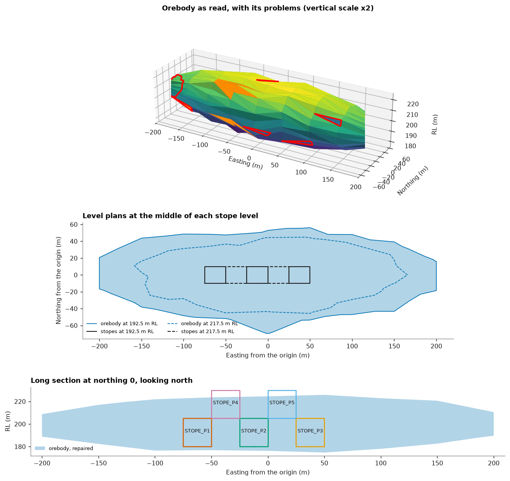
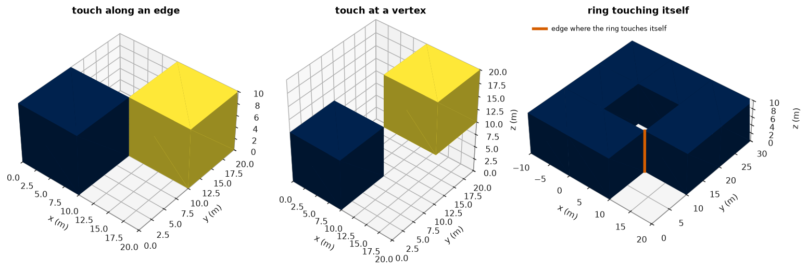

# Files and repair: from another package's export to a valid solid

A resource geologist receives two wireframes from two other packages: an orebody from a consultant as a
Datamine CSV pair, and a stope design from the planning team as a DXF. This example reads both files as those
packages write them, inspects what `validate` reports, repairs each one with explicit options, reads the repair
report line by line, converts between formats while keeping the attributes, and sets out the rules that decide
whether a mesh is a valid solid, including solids whose parts touch.

All data are seeded and synthetic, at UTM scale: easting near 700 000 m and northing near 7 500 000 m.
Elevations are reduced levels (RL) in metres above the mine datum. Lengths are in metres (m), areas in square
metres (m2) and volumes in cubic metres (m3). Figures use coordinates relative to the deposit origin
(`wf.datasets.ORIGIN`).

```python
import matplotlib.pyplot as plt
import numpy as np
import wireframes as wf
from common import HIGHLIGHT, INK, SERIES, save

O = wf.datasets.ORIGIN
folder = Path(tempfile.mkdtemp())
```

## 1. Terms

A *wireframe* is a mesh of triangles that share corners (*vertices*). A *solid* is a wireframe that encloses a
volume: every edge joins exactly two triangles, the triangles of each closed part (a *shell*) wind the same way,
all shells face outward, and no two triangles cut through each other. Section 7 gives the full rules. An
*open surface*, such as topography, has *boundary edges* that belong to one triangle only.

The orebody comes from the package's own loft of 9 cross-sections (`wf.datasets.orebody`), with coordinates
rounded to the millimetre as the consultant's export writes them. Rounding moves each vertex by up to 0.5 mm
and changes the volume by a few cubic metres, so the true volume for this example is the volume of the rounded
solid.

```python
lens = wf.datasets.orebody(seed=3)
mm = np.array([[float(f"{c:.3f}") for c in p] for p in lens.coords])
truth = wf.Mesh(mm, lens.triangles, face_attributes={"section": lens["section"]}, length_unit="m")
print(truth)
print(f"true volume {truth.volume:,.3f} m3, solid: {truth.is_solid}")
print(f"rounding to the millimetre changed the volume by {truth.volume - lens.volume:+.3f} m3")
assert truth.is_solid
```

```text
Mesh(216 vertices, 428 triangles, columns ["section"], crs None, length_unit m)
true volume 1,326,818.613 m3, solid: True
rounding to the millimetre changed the volume by +2.370 m3
```

## 2. The Datamine pair as the consultant wrote it

A Datamine wireframe is two tables. The *point file* `<name>_pt.csv` holds one row per vertex: `XP`, `YP`, `ZP`
and a point id `PID`. The *triangle file* `<name>_tr.csv` holds one row per triangle: a triangle id and the
three point ids `PID1`, `PID2`, `PID3`, followed by attribute columns. This export uses a European locale:
`;` between fields, `,` as the decimal mark, Windows line ends, a trailing `;` on every row and a row of field
types (`N` numeric, `A` text) under the header. Point ids have gaps, as they do after points are deleted in an
editor, and `-1,0E30` marks an absent value: the end caps have no `SECTION`.

The export also carries defects of the kind exchange files often hold. The cell below plants them and keeps
the counts, so the validation report can be checked against them:

- every triangle wound clockwise seen from outside (an *inward* solid), except 5 triangles wound the other way;
- the two end caps written with their own copies of the points they share with the sides;
- 4 triangles written twice, and 2 triangles that repeat a point id (*degenerate*: they have no area);
- one triangle missing, which leaves a *hole*.

```python
rng = np.random.default_rng(8)
n_true = truth.n_faces
rows = truth.triangles[:, ::-1].copy()
missing = int(rng.integers(1, n_true))
flipped = rng.choice(np.setdiff1d(np.arange(1, n_true), [missing]), 5, replace=False)
rows[flipped] = rows[flipped][:, ::-1]
points = list(mm)
cap_copy = {}
for f in np.flatnonzero(truth["section"] < 0):
    for c in range(3):
        v = rows[f, c]
        if v not in cap_copy:
            cap_copy[v] = len(points)
            points.append(mm[v])
        rows[f, c] = cap_copy[v]
kept = np.setdiff1d(np.arange(n_true), [missing])
twice = rng.choice(kept, 4, replace=False)
degenerate = np.array([[rows[3, 0], rows[3, 1], rows[3, 0]], [rows[40, 2], rows[40, 1], rows[40, 1]]])
triangles = np.vstack([rows[kept], rows[twice], degenerate])
sections = np.concatenate([truth["section"][kept], truth["section"][twice], truth["section"][[3, 40]]])
pid = 1 + np.cumsum(rng.integers(1, 4, len(points)))
print(f"{len(points)} points ({len(cap_copy)} cap copies), {len(triangles)} triangles written")
```

```text
264 points (48 cap copies), 433 triangles written
```

The first rows of each file:

```python
for name in ("lens_pt.csv", "lens_tr.csv"):
    print(name, "|", " | ".join((folder / name).read_text().splitlines()[:4]))
```

```text
lens_pt.csv | XP;YP;ZP;PID; | N;N;N;N; | 699800,000;7499975,567;200,000;2; | 699800,000;7499977,146;197,448;4;
lens_tr.csv | TRIANGLE;PID1;PID2;PID3;ZONE;SECTION; | N;N;N;N;A;N; | 1;81;83;34;"LENS1";0; | 2;83;36;34;"LENS1";0;
```

`wf.read` takes either file of the pair. It sniffs the delimiter, skips the type row, maps the point ids to
vertex numbers and keeps the columns after `PID3` as face columns. Text stays text (`ZONE`), numbers become
64-bit floats (`SECTION`), and `-1,0E30` becomes a null, shown as `NaN` and as `False` in the column's mask.
The file declares no unit, so the call sets `length_unit="m"`; a coordinate reference system (`crs`) can be
set the same way.

```python
data = wf.read(folder / "lens_tr.csv", length_unit="m", crs="EPSG:31983")
orebody = data.mesh
print(orebody, data.warnings)
print("ZONE:", orebody["ZONE"][:3], " SECTION:", orebody["SECTION"][:3])
print(
    "triangles with a SECTION value:",
    int(orebody.face_attributes.mask("SECTION").sum()),
    "of",
    orebody.n_faces,
)
assert orebody.n_vertices == len(points) and orebody.n_faces == len(triangles)
assert np.array_equal(orebody.coords, np.array(points))
```

```text
Mesh(264 vertices, 433 triangles, columns ["ZONE", "SECTION"], crs EPSG:31983, length_unit m) []
ZONE: ['LENS1' 'LENS1' 'LENS1']  SECTION: [0. 0. 0.]
triangles with a SECTION value: 389 of 433
```

## 3. What validate reports

`validate` checks the mesh with exact arithmetic and returns a `MeshReport`. `summary` counts each kind of
problem; `problems` is a table with one row per problem and the face, vertex and local edge (0, 1 or 2) it
concerns. Each count traces back to a planted defect:

- `degenerate_faces` and `duplicate_faces` are the 2 and 4 planted rows;
- `duplicate_vertices` are the cap copies, which sit on the same coordinates as the side vertices;
- `boundary_edges` and `non_manifold_edges` (edges with three or more triangles) come from the seams the copies
  open around each cap, from the missing triangle and from the repeated triangles;
- `inconsistent_edges` are edges whose two triangles run the same way, around the 5 counter-wound triangles.

The orebody is not closed, so `volume` refuses it with `wf.InvalidMesh`, and so does every boolean.

```python
report = orebody.validate()
print({k: v for k, v in report.summary.items() if v})
problems = report.problems
print("kinds in the table:", sorted(set(problems["kind"])))
first = problems.filter(problems["kind"] == "duplicate_face")
print(
    "duplicate faces and the earlier face each repeats:",
    list(zip(first["face"].tolist(), first["other"].tolist(), strict=True)),
)
assert report.summary["degenerate_faces"] == 2 and report.summary["duplicate_faces"] == 4
assert report.summary["duplicate_vertices"] == len(cap_copy)
try:
    _ = orebody.volume
except wf.InvalidMesh as error:
    print(f"{type(error).__name__}: {error}")
else:
    raise AssertionError("an open mesh must have no volume")
```

```text
{'degenerate_faces': 2, 'duplicate_faces': 4, 'duplicate_vertices': 48, 'boundary_edges': 99, 'non_manifold_edges': 12, 'inconsistent_edges': 15, 'shells': 3}
kinds in the table: ['boundary_edge', 'degenerate_face', 'duplicate_face', 'duplicate_vertex', 'inconsistent_winding', 'non_manifold_edge']
duplicate faces and the earlier face each repeats: [(427, 244), (428, 20), (429, 186), (430, 166)]
InvalidMesh: invalid mesh: volume needs a closed, consistently wound mesh: degenerate_faces=2, duplicate_faces=4, duplicate_vertices=48, boundary_edges=99, non_manifold_edges=12, inconsistent_edges=15; the error's report lists each problem (as mesh.validate() does), and mesh.repair() or repair=True fixes what repair can
```

## 4. Repairing the orebody and reading the repair report

`repair` returns a new mesh and a `RepairReport`; the mesh read from the file is left as it was. The steps run
in a fixed order: weld vertices with equal coordinates (`weld=0.0`, the default), remove degenerate faces,
remove duplicate faces, remove unused vertices, orient every shell consistently and outward, and fill holes.
Hole filling runs only when asked for: `fill_holes="min_area"` closes each hole with the triangulation of least
area. Self-intersections are never repaired.

The report has one row per change in `actions`, a count per kind in `summary`, the validation summaries
`before` and `after`, `holes_left`, and two maps: `vertex_map` gives the output vertex of each input vertex and
`face_map` the output face of each input face, with -1 for a removed one.

```python
lens_fixed, log = orebody.repair(fill_holes="min_area")
print(log)
actions = log.actions
print("columns of actions:", actions.column_names)
removed = actions.filter(actions["action"] == "face_removed")
print(
    "removed faces and why:", sorted(zip(removed["face"].tolist(), removed["reason"].tolist(), strict=True))
)
print(
    f"after: solid {log.after['is_solid']}, holes left {log.holes_left}, volume {lens_fixed.volume:,.3f} m3"
)
```

```text
RepairReport(vertex_merged=48, vertex_split=0, vertex_removed=0, face_removed=6, face_flipped=422, face_added=1, holes_left=0)
columns of actions: ['action', 'vertex', 'face', 'other', 'reason']
removed faces and why: [(427, 'duplicate_face'), (428, 'duplicate_face'), (429, 'duplicate_face'), (430, 'duplicate_face'), (431, 'degenerate_face'), (432, 'degenerate_face')]
after: solid True, holes left 0, volume 1,326,818.613 m3
```

The counts of the report must balance against the input, and the repaired volume must equal the true volume:

- every merged vertex is a cap copy, and input vertices minus merged vertices are the output vertices;
- input faces minus removed faces plus added faces are the output faces;
- the whole solid was inward, so `orient` flips every kept triangle except the 5 that were already outward;
- the triangle that fills the hole is the missing one, so the volume comes back to the true volume, to within
  floating-point rounding (relative 1e-9).

A second `repair` of the output changes nothing.

```python
s = log.summary
print(
    f"vertices {orebody.n_vertices} - merged {s['vertex_merged']} = {orebody.n_vertices - s['vertex_merged']}"
    f" = output {lens_fixed.n_vertices}"
)
print(
    f"faces {orebody.n_faces} - removed {s['face_removed']} + added {s['face_added']} = "
    f"{orebody.n_faces - s['face_removed'] + s['face_added']} = output {lens_fixed.n_faces}"
)
print(f"flipped {s['face_flipped']} = kept {n_true - 1} - already outward {len(flipped)}")
print(f"repaired - true volume = {lens_fixed.volume - truth.volume:+.1e} m3")
assert (
    s["vertex_merged"] == len(cap_copy) and lens_fixed.n_vertices == orebody.n_vertices - s["vertex_merged"]
)
assert lens_fixed.n_faces == orebody.n_faces - s["face_removed"] + s["face_added"]
assert s["face_removed"] == 6 and s["face_added"] == 1 and log.holes_left == 0
assert s["face_flipped"] == n_true - 1 - len(flipped)
assert (log.face_map >= 0).sum() == orebody.n_faces - s["face_removed"]
assert lens_fixed.is_solid and abs(lens_fixed.volume - truth.volume) <= 1e-9 * truth.volume
assert len(lens_fixed.repair(fill_holes="min_area")[1]) == 0
```

```text
vertices 264 - merged 48 = 216 = output 216
faces 433 - removed 6 + added 1 = 428 = output 428
flipped 422 = kept 427 - already outward 5
repaired - true volume = +4.7e-10 m3
```

Face columns follow their faces through `face_map`. The added face has no source in the file, so `repair`
leaves its columns null instead of guessing. Here the zone is known, so the script sets it on purpose; the
section number stays null, as it is on the end caps.

```python
added = actions.filter(actions["action"] == "face_added")["face"]
print("added face", added, "ZONE", lens_fixed["ZONE"][added], "SECTION", lens_fixed["SECTION"][added])
lens_fixed = lens_fixed.with_face_column("ZONE", ["LENS1"] * lens_fixed.n_faces)
assert lens_fixed.is_solid and set(lens_fixed["ZONE"]) == {"LENS1"}
```

```text
added face [427] ZONE [None] SECTION [nan]
```

## 5. The stope DXF as the planning package wrote it

A *stope* is the opening from which ore is mined. The planning team designed *primary stopes*, the first to be
mined, in a *checkerboard*: on a long section (a vertical section along the lens) the stopes of one level sit
below the gaps of the level above, and the rock between them (the *secondary stopes*) is mined later, once the
primaries are filled. Each stope is 25 m along strike, 20 m across and 25 m high, so 12 500 m3. In a
checkerboard, each upper stope touches the two stopes below it along one horizontal edge.

The DXF is written as many packages write it: an `ENTITIES` section only (no `HEADER`, so no `$INSUNITS`
unit), one `3DFACE` per triangle with its fourth corner repeating the third, one layer and colour per stope,
coordinates with three decimals and Windows line ends. It also holds a title block in paper space and an
`INSERT` of a north-arrow block. One defect is planted: two triangles of the last stope put one of its corners
1 mm east of where its other triangles put it, as happens when a corner is snapped again after an edit.

```python
STOPE = np.array([25.0, 20.0, 25.0])
cells = [(-3, 0), (-1, 0), (1, 0), (-2, 1), (0, 1)]
design = [
    wf.datasets.box(O + [25.0 * i, -10.0, 180.0 + 25.0 * j], O + [25.0 * i, -10.0, 180.0 + 25.0 * j] + STOPE)
    for i, j in cells
]
faces3d = []
for k, stope in enumerate(design):
    for t in stope.coords[stope.triangles]:
        faces3d.append((f"STOPE_P{k + 1}", k + 1, t.copy()))
corner = design[-1].coords[7]
moved = [i for i, (_, colour, t) in enumerate(faces3d) if colour == 5 and (t == corner).all(axis=1).any()][
    -2:
]
for i in moved:
    t = faces3d[i][2]
    t[(t == corner).all(axis=1)] += [0.001, 0.0, 0.0]
print(f"{len(faces3d)} 3DFACE entities on {len(design)} layers; corner moved in faces {moved}")
```

```text
60 3DFACE entities on 5 layers; corner moved in faces [55, 59]
```

The first 3DFACE in the file:

```python
print(" | ".join((folder / "stopes.dxf").read_text().splitlines()[2:30]))
```

```text
  2 | ENTITIES |   0 | 3DFACE |   8 | STOPE_P1 |  62 | 1 |  10 | 699925.000 |  20 | 7499990.000 |  30 | 180.000 |  11 | 699925.000 |  21 | 7500010.000 |  31 | 180.000 |  12 | 699950.000 |  22 | 7499990.000 |  32 | 180.000 |  13 | 699950.000
```

`wf.read` reads model space only. It skips the paper-space title and the `INSERT` and says so in `warnings`, so
a script can refuse a file that holds geometry it did not read. A `3DFACE` whose fourth corner repeats the third
is a triangle. Triangles stored as loose corners are joined into a mesh by merging corners with equal
coordinates, so stopes that touch share the vertices where they touch. The layer and colour of each entity
become the face columns `layer` and `color`.

```python
data = wf.read(folder / "stopes.dxf", length_unit="m")
stopes = data.mesh
print(stopes)
print("unit declared by the file:", data.length_unit)
print("warnings:", data.warnings)
print("layers:", sorted(set(stopes["layer"])), " colours:", sorted(set(stopes["color"].tolist())))
assert stopes.n_faces == len(faces3d) and len(data.warnings) == 2
```

```text
Mesh(33 vertices, 60 triangles, columns ["layer", "color"], crs None, length_unit m)
unit declared by the file: None
warnings: ['skipped 1 INSERT entities', 'skipped 1 paper space entities (group 67 = 1); only model space is read']
layers: ['STOPE_P1', 'STOPE_P2', 'STOPE_P3', 'STOPE_P4', 'STOPE_P5']  colours: [1, 2, 3, 4, 5]
```

Validated with the default `tolerance=0.0`, the moved corner shows as 4 boundary edges, so the last stope is not
closed, plus one self-intersection where its two loose triangles meet the rest of its top face.
`validate(tolerance=0.002)` also reports vertices within 2 mm of each other as duplicates, which points at the
cause. Contacts count only between closed shells: the two touching edges between closed lower and upper stopes
are in `touching_shell_edges`, and their ends in `touching_shell_vertices`, as information, not defects. The
two edges where the open stope meets the stopes below it show as 4 non-manifold vertices instead.

```python
exact = stopes.validate()
near = stopes.validate(tolerance=0.002)
print("tolerance 0    :", {k: v for k, v in exact.summary.items() if v})
print("tolerance 2 mm :", {k: v for k, v in near.summary.items() if v})
dup = near.problems.filter(near.problems["kind"] == "duplicate_vertex")
gap = stopes.coords[dup["vertex"]] - stopes.coords[dup["other"]]
print("duplicate vertex pairs within 2 mm, and their distance (m):", np.round(np.linalg.norm(gap, axis=1), 6))
assert exact.summary["boundary_edges"] > 0 and near.summary["duplicate_vertices"] == 1
assert exact.summary["touching_shell_edges"] == 2 and exact.summary["non_manifold_vertices"] == 4
```

```text
tolerance 0    : {'boundary_edges': 4, 'non_manifold_vertices': 4, 'shells': 5, 'self_intersections': 1, 'touching_shell_edges': 2, 'touching_shell_vertices': 4}
tolerance 2 mm : {'duplicate_vertices': 1, 'boundary_edges': 4, 'non_manifold_vertices': 4, 'shells': 5, 'self_intersections': 1, 'touching_shell_edges': 2, 'touching_shell_vertices': 4}
duplicate vertex pairs within 2 mm, and their distance (m): [0.001]
```

`repair(weld=0.002)` merges vertices within 2 mm and keeps the earliest of each group, so the corner goes back
to where most of its triangles put it. The report then shows a second kind of change: `vertex_split`. The DXF
reader joined the stopes at their contacts by sharing vertices; `repair` gives each closed stope its own copy of
each contact vertex, so the stopes stay separate shells that touch, and nothing is merged across stopes by
accident. `weld_touching_shells=True` keeps them shared instead. Either form is a valid solid.

```python
stopes_fixed, stope_log = stopes.repair(weld=0.002)
print(stope_log)
print("after:", {k: v for k, v in stope_log.after.items() if v})
splits = stope_log.actions.filter(stope_log.actions["action"] == "vertex_split")
print("contact vertices split:", splits["vertex"].tolist())
volumes = [p.volume for p in stopes_fixed.components()]
print("stope volumes (m3):", volumes, f" total {stopes_fixed.volume:,.1f} m3")
print("layers per stope:", [sorted(set(p["layer"])) for p in stopes_fixed.components()])
assert stopes_fixed.is_solid and stope_log.summary["vertex_merged"] == 1
assert stope_log.after["touching_shell_edges"] == 4 and stope_log.after["touching_shell_vertices"] == 8
assert stope_log.summary["vertex_split"] == 8 and stopes_fixed.n_vertices == stopes.n_vertices - 1 + 8
assert volumes == [STOPE.prod()] * len(design) and stopes_fixed.volume == len(design) * STOPE.prod()
```

```text
RepairReport(vertex_merged=1, vertex_split=8, vertex_removed=0, face_removed=0, face_flipped=0, face_added=0, holes_left=0)
after: {'shells': 5, 'touching_shell_edges': 4, 'touching_shell_vertices': 8, 'is_closed': True, 'is_solid': True}
contact vertices split: [5, 7, 12, 13, 14, 15, 20, 22]
stope volumes (m3): [12500.0, 12500.0, 12500.0, 12500.0, 12500.0]  total 62,500.0 m3
layers per stope: [['STOPE_P1'], ['STOPE_P2'], ['STOPE_P3'], ['STOPE_P4'], ['STOPE_P5']]
```

With both inputs valid, booleans accept them. The ore inside the stopes and the waste inside the stopes must add
up to the stope volume; booleans decide every crossing with exact predicates, and the identity holds to
rounding.

```python
ore_in = stopes_fixed & lens_fixed
waste_in = stopes_fixed - lens_fixed
print(f"ore in stopes {ore_in.volume:,.1f} m3 + waste in stopes {waste_in.volume:,.1f} m3")
print(
    f"  - stopes {stopes_fixed.volume:,.1f} m3 = {ore_in.volume + waste_in.volume - stopes_fixed.volume:+.1e} m3"
)
assert ore_in.is_solid and waste_in.is_solid
assert abs(ore_in.volume + waste_in.volume - stopes_fixed.volume) <= 1e-9 * stopes_fixed.volume
```

```text
ore in stopes 56,702.8 m3 + waste in stopes 5,797.2 m3
  - stopes 62,500.0 m3 = +0.0e+00 m3
```

The 3D view shows the orebody as read, in coordinates local to the deposit origin and with the vertical scale
doubled, with its boundary edges in red and the other problem triangles in orange: the seams around both end
caps, the hole, and the counter-wound triangles. The level plans are horizontal slices of the repaired orebody
and the stopes at 192.5 m RL, the middle of the lower level, and 217.5 m RL, the middle of the upper level. The
long section is a vertical slice along strike through the middle of the lens (northing 0), looking north; the
four touching edges are the corners where an upper stope meets a lower one.

```python
fig = plt.figure(figsize=(10, 9.5), layout="constrained")
grid = fig.add_gridspec(3, 1, height_ratios=[1.0, 0.6, 0.6])
ax1 = fig.add_subplot(grid[0], projection="3d")
wf.plot.surface3d(orebody.translate(-O), ax=ax1, problems=report, azim=-60, elev=25)
ax1.set_box_aspect((400, 125, 100), zoom=1.25)
ax1.set_title("Orebody as read, with its problems (vertical scale x2)")
ax1.set_xlabel("Easting (m)")
ax1.set_ylabel("Northing (m)")
ax1.set_zlabel("RL (m)")
ax2 = fig.add_subplot(grid[1])
for rl, style, alpha in ((192.5, "-", 0.3), (217.5, "--", 0.0)):
    for k, part in enumerate(
        wf.Mesh(lens_fixed.coords, lens_fixed.triangles).slice_by_plane(O + [0, 0, rl], [0, 0, 1]).parts
    ):
        ring = np.vstack([part, part[:1]]) - O
        ax2.fill(ring[:, 0], ring[:, 1], color=SERIES[0], alpha=alpha, linewidth=0)
        ax2.plot(ring[:, 0], ring[:, 1], color=SERIES[0], linestyle=style, linewidth=1.0,
                 label=f"orebody at {rl} m RL" if k == 0 else None)  # fmt: skip
    for k, part in enumerate(
        wf.Mesh(stopes_fixed.coords, stopes_fixed.triangles).slice_by_plane(O + [0, 0, rl], [0, 0, 1]).parts
    ):
        ring = np.vstack([part, part[:1]]) - O
        ax2.plot(ring[:, 0], ring[:, 1], color=INK, linestyle=style, linewidth=1.2,
                 label=f"stopes at {rl} m RL" if k == 0 else None)  # fmt: skip
ax2.set_aspect("equal")
ax2.legend(loc="lower left", fontsize=7, ncols=2)
ax2.set_title("Level plans at the middle of each stope level")
ax2.set_xlabel("Easting from the origin (m)")
ax2.set_ylabel("Northing from the origin (m)")
ax3 = fig.add_subplot(grid[2])
for part in wf.Mesh(lens_fixed.coords, lens_fixed.triangles).slice_by_plane(O, [0.0, 1.0, 0.0]).parts:
    ring = np.vstack([part, part[:1]]) - O
    ax3.fill(ring[:, 0], ring[:, 2], color=SERIES[0], alpha=0.3, linewidth=0, label="orebody, repaired")
for k, stope in enumerate(stopes_fixed.components()):
    for part in wf.Mesh(stope.coords, stope.triangles).slice_by_plane(O, [0.0, 1.0, 0.0]).parts:
        ring = np.vstack([part, part[:1]]) - O
        ax3.plot(ring[:, 0], ring[:, 2], color=SERIES[(k + 2) % len(SERIES)], linewidth=1.4)
        ax3.annotate(stope["layer"][0], ring[:-1].mean(axis=0)[[0, 2]], ha="center", fontsize=7, color=INK)
ax3.set_aspect("equal")
ax3.set_xlim(-210, 210)
ax3.legend(loc="lower left", fontsize=7)
ax3.set_title("Long section at northing 0, looking north")
ax3.set_xlabel("Easting from the origin (m)")
ax3.set_ylabel("RL (m)")
save(fig, "files_repair_inputs")
```



## 6. Converting between formats and keeping attributes

Each format stores a different set of columns. A Datamine pair keeps any number of text and numeric columns.
DXF keeps only the face `layer` (text) and `color` (an AutoCAD colour index). PLY and VTK keep numeric columns
only. OBJ keeps the face `object` and `group` names. STL keeps none and stores 32-bit coordinates. `write`
raises `wf.InvalidInput` for a column the format cannot hold and names it; `skip_unsupported_columns=True`
drops such columns, so the loss is a choice written in the script.

To send the orebody to the planning package as DXF, the script puts the zone in the `layer` column, where CAD
users look for it, and drops `SECTION` on purpose.

```python
try:
    wf.write(folder / "lens.dxf", lens_fixed)
except wf.InvalidInput as error:
    print(f"{type(error).__name__}: {error}")
for_cad = lens_fixed.with_face_column("layer", lens_fixed["ZONE"])
wf.write(folder / "lens.dxf", for_cad, skip_unsupported_columns=True)
print(wf.read_mesh(folder / "lens.dxf").column_names)
```

```text
InvalidInput: dxf cannot store face column "ZONE" (utf8); it stores layer (utf8) and color (int64)
['layer']
```

Every conversion below writes the repaired mesh and reads it back. Text formats print each coordinate in its
shortest round-trip form, so the coordinates come back bit for bit, and so does the volume. The table gives the
columns that survived and the largest coordinate shift. Binary STL stores 32-bit floats: at a northing of 7.5
million they are 0.5 m apart, so the STL copy moves vertices and changes the volume, and `write` warns about it.

```python
conversions = [
    ("orebody", lens_fixed, "lens_out_tr.csv"),
    ("orebody", for_cad, "lens_out.dxf"),
    ("orebody", lens_fixed, "lens_out.vtu"),
    ("orebody", lens_fixed, "lens_out.ply"),
    ("orebody", lens_fixed, "lens_out.obj"),
    ("orebody", lens_fixed, "lens_out.stl"),
    ("stopes", stopes_fixed, "stopes_out_tr.csv"),
    ("stopes", stopes_fixed, "stopes_out.dxf"),
]
print(f"{'mesh':8} {'file':18} {'columns kept':28} {'shift (m)':>10} {'volume change (m3)':>19}")
for name, mesh, file in conversions:
    with warnings.catch_warnings(record=True) as caught:
        warnings.simplefilter("always")
        wf.write(folder / file, mesh, skip_unsupported_columns=True)
    back = wf.read_mesh(folder / file, length_unit="m")
    shift = np.abs(back.coords[back.triangles] - mesh.coords[mesh.triangles]).max()
    print(
        f"{name:8} {file:18} {', '.join(back.column_names) or '-':28} {shift:10.1e} "
        f"{back.volume - mesh.volume:19.1e}"
    )
    if file.endswith(".stl"):
        print("  warning:", str(caught[0].message).split(": ", 1)[1])
        assert 0.0 < shift <= 0.25
        continue
    assert shift == 0.0 and back.volume == mesh.volume and back.is_solid
```

```text
mesh     file               columns kept                  shift (m)  volume change (m3)
orebody  lens_out_tr.csv    ZONE, SECTION                   0.0e+00             0.0e+00
orebody  lens_out.dxf       layer                           0.0e+00             0.0e+00
orebody  lens_out.vtu       SECTION                         0.0e+00             0.0e+00
orebody  lens_out.ply       SECTION                         0.0e+00             0.0e+00
orebody  lens_out.obj       -                               0.0e+00             0.0e+00
orebody  lens_out.stl       -                               2.5e-01            -1.6e+02
  warning: binary stl stores coordinates as float32, so 216 of 216 vertices moved by up to 2.500e-1 and the mesh may no longer be valid; write ascii=True, or translate to a local origin first
stopes   stopes_out_tr.csv  layer, color                    0.0e+00             0.0e+00
stopes   stopes_out.dxf     layer, color                    0.0e+00             0.0e+00
```

Text columns survive the Datamine pair and DXF layers; numeric columns survive VTU and PLY, nulls included. The
stopes went through DXF and back as touching shells, so the reader shares their contact vertices again, and
the stope layers survived the Datamine pair as a text column.

```python
back = wf.read_mesh(folder / "lens_out.vtu")
print("SECTION nulls before and after VTU:", (~lens_fixed.face_attributes.mask("SECTION")).sum(), "and",
      (~back.face_attributes.mask("SECTION")).sum())  # fmt: skip
stopes_back = wf.read_mesh(folder / "stopes_out_tr.csv")
print("stope layers from the Datamine pair:", sorted(set(stopes_back["layer"])))
assert np.array_equal(back.face_attributes.mask("SECTION"), lens_fixed.face_attributes.mask("SECTION"))
```

```text
SECTION nulls before and after VTU: 45 and 45
stope layers from the Datamine pair: ['STOPE_P1', 'STOPE_P2', 'STOPE_P3', 'STOPE_P4', 'STOPE_P5']
```

## 7. The rules for a valid solid

`is_solid` is true when `validate` finds all of these:

1. *Closed*: every edge joins two triangles, or an even number of triangles that pair into wedges of solid
   around the edge (shells touching along that edge).
2. *Manifold*: around every vertex, the triangles of one shell form a single fan, unless each fan belongs to a
   closed shell (shells touching at that vertex).
3. *Consistent winding*: two triangles that share an edge run it in opposite directions.
4. *Outward*: each closed shell has positive signed volume, and a shell inside another one (a *cavity*) has
   negative signed volume. Nesting is decided by exact point-in-shell tests.
5. *No self-intersection or coplanar overlap*: no two triangles cross, touch away from their shared vertices,
   or overlap in one plane.
6. No degenerate or duplicate faces and no duplicate vertices, except copies of a vertex where closed shells
   touch.

Shells may touch each other along edges or at vertices, as the checkerboard stopes do, and one shell may touch
itself the same way, as a ring of stopes around a pillar does where the last stope meets the first at a
corner. Contacts are exact: only vertices and edges with equal coordinates count. Shells that share part or all
of a face, or meet on part of an edge, overlap, and `validate` reports them as coplanar overlaps or
self-intersections. Join such pieces with `union`, which merges shared faces into one shell.

The table runs `validate` on each case built from 10 m boxes.

```python
box = wf.datasets.box
pillar_ring = box([0, 0, 0], [10, 10, 10])
for i, j in [(-1, 0), (-1, 1), (-1, 2), (0, 2), (1, 2), (1, 1)]:
    pillar_ring = pillar_ring | box([10 * i, 10 * j, 0], [10 * i + 10, 10 * j + 10, 10])
cases = {
    "touch along an edge": wf.concat([box([0, 0, 0], [10, 10, 10]), box([10, 10, 0], [20, 20, 10])]),
    "touch at a vertex": wf.concat([box([0, 0, 0], [10, 10, 10]), box([10, 10, 10], [20, 20, 20])]),
    "ring touching itself": pillar_ring,
    "cavity, wound inward": wf.concat([box([0, 0, 0], [10, 10, 10]), box([2, 2, 2], [8, 8, 8]).flip()]),
    "cavity, wound outward": wf.concat([box([0, 0, 0], [10, 10, 10]), box([2, 2, 2], [8, 8, 8])]),
    "share a whole face": wf.concat([box([0, 0, 0], [10, 10, 10]), box([10, 0, 0], [20, 10, 10])]),
    "share part of a face": wf.concat([box([0, 0, 0], [10, 10, 10]), box([10, 5, 5], [20, 15, 15])]),
    "share part of an edge": wf.concat([box([0, 0, 0], [10, 10, 10]), box([10, 5, 10], [20, 15, 20])]),
    "overlap": wf.concat([box([0, 0, 0], [10, 10, 10]), box([5, 5, 5], [15, 15, 15])]),
}
keys = ["shells", "touching_shell_edges", "touching_shell_vertices", "inward_shells", "self_intersections",
        "coplanar_overlaps"]  # fmt: skip
print(
    f"{'case':24} {'shells':>6} {'touch e':>7} {'touch v':>7} {'inward':>6} {'crossing':>8} {'coplanar':>8}  solid"
)
for name, mesh in cases.items():
    summary = mesh.validate().summary
    print(f"{name:24} " + " ".join(f"{summary[k]:>{w}}" for k, w in zip(keys, (6, 7, 7, 6, 8, 8), strict=True))
          + f"  {summary['is_solid']}")  # fmt: skip
solid = {name: mesh.is_solid for name, mesh in cases.items()}
assert solid == {
    "touch along an edge": True,
    "touch at a vertex": True,
    "ring touching itself": True,
    "cavity, wound inward": True,
    "cavity, wound outward": False,
    "share a whole face": False,
    "share part of a face": False,
    "share part of an edge": False,
    "overlap": False,
}
assert len(pillar_ring.components()) == 1 and pillar_ring.validate().summary["touching_shell_edges"] == 1
```

```text
case                     shells touch e touch v inward crossing coplanar  solid
touch along an edge           2       1       2      0        0        0  True
touch at a vertex             2       0       1      0        0        0  True
ring touching itself          1       1       2      0        0        0  True
cavity, wound inward          2       0       0      0        0        0  True
cavity, wound outward         2       0       0      1        0        0  False
share a whole face            2       0       4      0        0        2  False
share part of a face          2       0       0      0       12        1  False
share part of an edge         2       0       0      0        8        0  False
overlap                       2       0       0      0       18        0  False
```

`repair` turns the outward cavity inward, since nesting decides the winding, and `union` turns two boxes that
share a face into one shell. Nothing fixes the overlapping cases: `repair` does not move vertices or cut
triangles, and every boolean refuses an input that overlaps itself (section 8).

```python
cavity, cavity_log = cases["cavity, wound outward"].repair()
print(
    f"cavity: {cavity_log.summary['face_flipped']} faces flipped, solid {cavity.is_solid}, volume {cavity.volume}"
)
merged = box([0, 0, 0], [10, 10, 10]) | box([10, 0, 0], [20, 10, 10])
print(f"union of the face-sharing boxes: {len(merged.components())} shell, volume {merged.volume}")
_, overlap_log = cases["overlap"].repair()
print("repair of the overlap:", len(overlap_log), "changes")
assert (
    cavity.is_solid and cavity.volume == 1000.0 - 216.0 and merged.volume == 2000.0 and len(overlap_log) == 0
)
```

```text
cavity: 12 faces flipped, solid True, volume 784.0
union of the face-sharing boxes: 1 shell, volume 2000.0
repair of the overlap: 0 changes
```

The figure shows the three valid contacts in 3D: two stopes along an edge, two at a vertex, and the ring of
seven stopes around a pillar whose first and last stopes touch along the vertical edge at (10, 10).

```python
fig = plt.figure(figsize=(11.5, 3.8), layout="constrained")
for k, name in enumerate(["touch along an edge", "touch at a vertex", "ring touching itself"]):
    ax = fig.add_subplot(1, 3, k + 1, projection="3d")
    mesh = cases[name]
    wf.plot.surface3d(mesh, mesh.component_labels(), ax=ax, cmap="cividis", azim=-50, elev=40)
    ax.set_title(name)
    ax.set_xlabel("x (m)")
    ax.set_ylabel("y (m)")
    ax.set_zlabel("z (m)")
ax.computed_zorder = False
ax.plot(
    [10, 10],
    [10, 10],
    [0, 10],
    color=HIGHLIGHT,
    linewidth=3,
    zorder=10,
    label="edge where the ring touches itself",
)
ax.legend(loc="upper left", fontsize=7)
save(fig, "files_repair_contacts")
```



## 8. What can go wrong

**Overlapping stopes stacked into one mesh.** `wf.concat` puts meshes together without checking them. If two
stopes overlap, the result is closed and consistently wound, so `volume` gives a number, but it counts the
overlap twice. `is_solid` is false, the report lists every crossing pair of triangles, and every boolean raises
`wf.InvalidMesh` with that report attached. Check `is_solid` before you report a volume or tonnes, and join
pieces that can overlap with `union`.

```python
a = design[0]
b = a.translate([10.0, 0.0, 0.0])
stacked = wf.concat([a, b])
print(
    f"stacked volume {stacked.volume:,.0f} m3, union volume {(a | b).volume:,.0f} m3, solid: {stacked.is_solid}"
)
bad = stacked.validate()
print({k: v for k, v in bad.summary.items() if v})
crossing = bad.problems.filter(bad.problems["kind"] == "self_intersection")
print(
    "first crossing pairs (face, other):",
    list(zip(crossing["face"][:4].tolist(), crossing["other"][:4].tolist(), strict=True)),
)
try:
    stacked & lens_fixed
except wf.InvalidMesh as error:
    print(f"{type(error).__name__}: {error}")
    assert error.report.summary["self_intersections"] == bad.summary["self_intersections"] > 0
else:
    raise AssertionError("overlapping stopes must be refused")
assert stacked.volume - (a | b).volume == (a & b).volume == 15.0 * 20.0 * 25.0
```

```text
stacked volume 25,000 m3, union volume 17,500 m3, solid: False
{'shells': 2, 'self_intersections': 40, 'coplanar_overlaps': 12, 'is_closed': True}
first crossing pairs (face, other): [(12, 4), (12, 5), (12, 6), (12, 10)]
InvalidMesh: invalid mesh: a: self_intersections=40, coplanar_overlaps=12; the error's report lists each problem (as mesh.validate() does), and mesh.repair() or repair=True fixes what repair can
```

**A repair that leaves a hole.** Without `fill_holes`, `repair` fixes everything else and leaves the hole open.
The report says so in `holes_left`, and the output is not a solid. A script should check both.

```python
open_lens, open_log = orebody.repair()
print(
    f"holes left {open_log.holes_left}, boundary edges {open_log.after['boundary_edges']}, solid {open_lens.is_solid}"
)
assert open_log.holes_left == 1 and not open_lens.is_solid
```

```text
holes left 1, boundary edges 3, solid False
```

**A file cut short.** A DXF must end with the `EOF` group. A file truncated in transfer raises `wf.FileError`
naming the last line read, instead of returning the stopes that happened to arrive.

```python
(folder / "cut.dxf").write_text(text[: len(text) // 2], newline="")
try:
    wf.read(folder / "cut.dxf")
except wf.FileError as error:
    print(f"{type(error).__name__}: {str(error).replace(f'{folder}/', '')}")
else:
    raise AssertionError("a truncated DXF must be refused")
```

```text
FileError: cut.dxf:918: file ends without the 0/EOF group; it is truncated
```

**A Datamine pair out of step.** If the point file lacks a point id that the triangle file uses, the reader
raises `wf.FileError` with the file and line of the first triangle that uses it.

```python
lost = int(pid[triangles[0, 1]])
(folder / "step_pt.csv").write_text(
    "\r\n".join(line for line in pt_lines if not line.endswith(f";{lost};")) + "\r\n", newline=""
)
(folder / "step_tr.csv").write_text("\r\n".join(tr_lines) + "\r\n", newline="")
try:
    wf.read(folder / "step_tr.csv")
except wf.FileError as error:
    print(f"{type(error).__name__}: {str(error).replace(f'{folder}/', '')}")
else:
    raise AssertionError("a missing point id must be refused")
```

```text
FileError: step_tr.csv:3: _tr.csv uses PID 83, missing from _pt.csv
```

**A unit that disagrees with the file.** The DXF written in section 6 declares metres in its header. Reading it
with `length_unit="ft"` raises `wf.InvalidInput`; `wireframes` never rescales coordinates on read. Use
`to_length_unit` to convert after reading.

```python
try:
    wf.read(folder / "lens.dxf", length_unit="ft")
except wf.InvalidInput as error:
    print(f"{type(error).__name__}: {str(error).replace(f'{folder}/', '')}")
else:
    raise AssertionError("a disagreeing unit must be refused")
```

```text
InvalidInput: lens.dxf: length_unit "ft" disagrees with the file unit "m"
```

Full script: [`example_08.py`](example_08.py), run by `mise run examples`.
